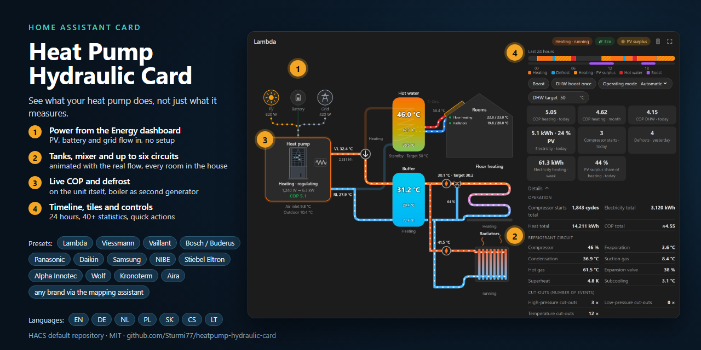

# Heat Pump Hydraulic Card

[](https://www.hacs.xyz/docs/use/repositories/dashboard/#search-repositories)
[](LICENSE)
[](https://github.com/Sturmi77/heatpump-hydraulic-card/actions/workflows/validate.yml)
[](https://github.com/Sturmi77/heatpump-hydraulic-card/releases)

[](https://my.home-assistant.io/redirect/hacs_repository/?owner=Sturmi77&repository=heatpump-hydraulic-card&category=plugin)



An **animated hydraulic schematic** for heat pumps in Home Assistant: air, ground (brine) and groundwater sources.

It shows electricity flowing from **PV, battery and grid** into the heat pump, the **diverter valve** switching between hot water and heating, colour-coded **tanks**, the **heating circuits** and your rooms. Animation speed follows the real flow rate. The core is vendor-neutral, and **presets** make it zero-config for popular heat pumps ([supported heat pumps](#supported-heat-pumps)).

**[Try the live demo](https://sturmi77.github.io/heatpump-hydraulic-card/demo/)**: every preset in heating, hot water, defrost and standby, with the matching card configuration. Runs in the browser with simulated data, no Home Assistant needed.

## Getting started

1. **Install** the card through HACS: search for **Heat Pump Hydraulic Card**, download it and reload the browser ([details](#installation)).
2. **Add the card**: edit a dashboard, *Add card*, pick **Heat Pump Hydraulic Card**. It looks for a supported integration and fills in the preset; without one it shows a short start hint.
3. **Check the preset** in the card editor: the preset field says *Detected* and how many entities it found. If no supported preset is detected, select the heat-pump device in the mapping assistant, review its conservative proposals, or map your entities yourself ([any other heat pump](#any-other-heat-pump)).
4. **Answer the editor's questions**: where the integration cannot tell how the installation is built (a buffer without sensors, the pump of a ViCare installation without a buffer, heating circuits that start at number 2), the editor asks above the fields. The preview shows each answer; it is saved with the card ([FAQ](docs/FAQ.md)).
5. **Fix what the editor reports**: *Check these fields* lists entities that do not fit their field (a temperature as the valve, a counter as the heater, the same sensor in two places), *Missing in the card* lists what the card cannot show without an entity, and entities the preset would use but that are disabled in Home Assistant. The most important fields come first in each group; the rest are under *More fields*.
6. **Something looks wrong?** Look up the symptom under [Troubleshooting](#troubleshooting). Still stuck: copy the diagnostic report (document button on the card), check it for private names and paste it into a [preset feedback issue](https://github.com/Sturmi77/heatpump-hydraulic-card/issues/new?template=preset_feedback.yml).


## Supported heat pumps

Each entry names the brands, the preset with its setup page, the integration it reads, how it was tested and its coverage.

- **Lambda** (EU-L series): preset [`lambda`](docs/presets/lambda.md), integration [lambda_heat_pumps](https://github.com/GuidoJeuken-6512/lambda_heat_pumps) (HACS). Tested on a real installation. Coverage [100 %](docs/COVERAGE.md#lambda).
- **Panasonic** Aquarea (H, J, K, L generation; monoblock, split, all-in-one): preset [`heishamon`](docs/presets/heishamon.md), integration [HeishaMon](https://github.com/heishamon/HeishaMon) with [heishamon-homeassistant](https://github.com/kamaradclimber/heishamon-homeassistant) (HACS). Confirmed on a real installation. Coverage [92 %](docs/COVERAGE.md#heishamon), 1 open.
- **Kronoterm** (ADAPT, ETERA, VERSI, WPLV …): preset [`kronoterm`](docs/presets/kronoterm.md), integration [Kronoterm](https://github.com/Favio25/Kronoterm-homeassistant) (HACS), Cloud API or Modbus. Cloud API confirmed on a real installation; Modbus from the integration source. Coverage [100 %](docs/COVERAGE.md#kronoterm).
- **Viessmann** (Vitocal): preset [`vicare`](docs/presets/vicare.md), integration [ViCare](https://www.home-assistant.io/integrations/vicare/) (core). Tested on real installations (Vitocal 250, Vitocal 200-S). Coverage [76 %](docs/COVERAGE.md#vicare), 3 open.
- **Viessmann** (Vitocal): preset [`open3e`](docs/presets/open3e.md), integration [Open3E](https://github.com/MojoOli/open3e-ha) (HACS, MQTT). Confirmed on a real installation (two heating circuits). Coverage [92 %](docs/COVERAGE.md#open3e), 1 open.
- **Vaillant** (aroTHERM, aroTHERM plus), **Saunier Duval**, **Bulex**, **Glow-worm**, **DemirDöküm**: preset [`vaillant`](docs/presets/vaillant.md), integration [myPyllant](https://github.com/signalkraft/mypyllant-component) (HACS). Confirmed on one aroTHERM plus installation. Coverage [100 %](docs/COVERAGE.md#vaillant).
- **Bosch**, **Buderus**, **Junkers**, **Nefit**, **Worcester**, **Sieger**, **elm.leblanc**, **iVT** (EMS/EMS+ heat pumps such as Buderus Logatherm WLW, Bosch Compress, Nefit EnviLine): preset [`emsesp`](docs/presets/emsesp.md), integration [EMS-ESP](https://github.com/emsesp/EMS-ESP32) gateway (MQTT discovery). Confirmed on a Buderus Logatherm WLW186i installation. Coverage [100 %](docs/COVERAGE.md#emsesp).
- **Bosch**, **Buderus**, **iVT**, **Junkers**, **Nefit**, **Worcester**, **Vulcano** heat pumps in the Bosch/Buderus app cloud (PointT, for example with an MX400 gateway; from integration 0.9.0 also the local access of K40/K40RF gateways), air and ground source: preset [`bosch_buderus_heating`](docs/presets/bosch-buderus-home-comfort.md), integration [Bosch/Buderus Home Comfort](https://github.com/SoftwareSchmied/ha-bosch-buderus-heating) (HACS, `bosch_buderus_heating`). Untested (mapping checked against a manual configuration on one installation). Coverage [100 %](docs/COVERAGE.md#bosch_buderus_heating).
- **Vaillant** aroTHERM / aroTHERM plus (HMU) with a VWZ hydraulic station and sensoCOMFORT / multiMATIC controller: preset [`ebusd`](docs/presets/ebusd.md), integration [ebusd](https://github.com/john30/ebusd) with Home Assistant MQTT discovery. Tested on real installations (aroTHERM plus cascade with two circuits, aroTHERM plus with a buffer). Coverage [100 %](docs/COVERAGE.md#ebusd).
- **Wolf** air/water heat pumps (CHA monoblock) with a WOLF Link gateway: preset [`wolf`](docs/presets/wolf.md), integration [Wolf SmartSet Service](https://www.home-assistant.io/integrations/wolflink/) (core, `wolflink`) or [Wolf SmartSet (read/write)](https://github.com/tibuntu/homeassistant-wolf-smartset) (HACS, `wolf_smartset`). `wolf_smartset` confirmed on a real installation (CHA); `wolflink` from the entity states of the same installation. Coverage [100 %](docs/COVERAGE.md#wolf).
- **Alpha Innotec**, **Novelan**, **Roth**, **Siemens**, **Elco**, **Buderus**, **Nibe**, **Wolf** heat pumps with a Luxtronik controller: preset [`luxtronik`](docs/presets/luxtronik.md), integration [Luxtronik](https://github.com/BenPru/luxtronik) (HACS, `luxtronik2`). Confirmed on one water-to-water installation; air and brine reports welcome. Coverage [93 %](docs/COVERAGE.md#luxtronik), 1 open.
- **NIBE** F series (F370, F470, F730, F750 exhaust air; F1145, F1155, F1245, F1255 brine): preset [`nibe`](docs/presets/nibe.md), integration [NIBE Heat Pump](https://www.home-assistant.io/integrations/nibe_heatpump/) (core, local Modbus or NIBE gateway). Untested (built from the integration's coil lists and an F470 entity list). Coverage [80 %](docs/COVERAGE.md#nibe), 2 open.
- **Stiebel Eltron** (WPM 3, WPM 3i, WPMsystem, LWZ) and **Tecalor** heat pumps with an ISG: preset [`stiebel_isg`](docs/presets/stiebel-isg.md), integration [Stiebel Eltron ISG](https://github.com/pail23/stiebel_eltron_isg_component) (HACS, `stiebel_eltron_isg`). Confirmed on a WPMsystem; WPM 3, WPM 3i and LWZ from the integration source. Coverage [100 %](docs/COVERAGE.md#stiebel_isg).
- **Stiebel Eltron** LWZ and **Tecalor** THZ integral units without an ISG (LWZ 303/403/404/504, THZ 303/304/403/404/504, LWZ 5/8 CS) on the serial service interface: preset [`thz`](docs/presets/thz.md), integration [THZ](https://github.com/bigbadoooff/thz) (HACS, `thz`). Built from the integration source by its maintainer and checked on one installation (LWZ 5 CS Premium). Coverage [100 %](docs/COVERAGE.md#thz).
- **Samsung** EHS (Mono, Split, TDM) on the NASA bus: preset [`samsung`](docs/presets/samsung.md), integration [esphome-samsung-nasa](https://github.com/Beormund/esphome-samsung-nasa) (ESPHome). Tested on a real installation. Coverage [100 %](docs/COVERAGE.md#samsung).
- **Samsung** EHS on the NASA bus with an RS485 bridge: preset [`ehs_sentinel`](docs/presets/ehs-sentinel.md), integration [EHS Sentinel](https://github.com/echoDaveD/ehs_sentinel_hacs_integration) (HACS). Untested (built from the integration's NASA repository and the entity list of one installation). Coverage [100 %](docs/COVERAGE.md#ehs_sentinel).
- **Daikin** Altherma, **ROTEX** (Altherma 3, LT, EPRA, ERGA, EBLA …): preset [`espaltherma`](docs/presets/espaltherma.md), integration [ESPAltherma](https://github.com/raomin/ESPAltherma) (ESP32 on the X10A port, MQTT device discovery of the beta branch). Tested on a real installation (EPRA12EAV3, heating and hot water). Coverage [92 %](docs/COVERAGE.md#espaltherma), 1 open.
- **Aira** (6, 8 and 12 kW): preset [`airahome`](docs/presets/airahome.md), integration [ha-airahome](https://github.com/Invy55/ha-airahome) (HACS, Bluetooth). Untested (built from the integration source and the entity list of one installation). Coverage [100 %](docs/COVERAGE.md#airahome).
- **Any other heat pump**: no preset; the editor's mapping assistant or your own `entities` ([any other heat pump](#any-other-heat-pump)).

Which preset should come next? Vote in the [poll](https://github.com/Sturmi77/heatpump-hydraulic-card/discussions/424) or name your heat pump there.

*Coverage* is the share of the core fields (the fields the editor shows first) that the preset fills, out of those its integration offers; open fields could still be mapped or need checking. It is generated from the card, and [docs/COVERAGE.md](docs/COVERAGE.md) has the details: the fields an integration does not offer and why, the further fields, stat tiles and texts. Which outdoor-unit drawing each preset selects is listed under [Outdoor-unit style coverage](docs/CONFIGURATION.md#outdoor-unit-style-coverage).

> [!NOTE]
> Presets marked *untested* are built from the source code of their integration and checked with simulated data. Please report whether they work on your installation: [preset feedback form](https://github.com/Sturmi77/heatpump-hydraulic-card/issues/new?template=preset_feedback.yml), with the diagnostic report after reviewing its entity ids for private names. Other heat pumps work with your own entity mapping ([any other heat pump](#any-other-heat-pump)).

## Current status

The current release is **[0.20.0](https://github.com/Sturmi77/heatpump-hydraulic-card/releases/tag/v0.20.0)**: the editor asks where the integration cannot tell how the installation is built (buffer, pump, first heating circuit), new presets for NIBE F series, Samsung EHS with EHS Sentinel, Aira and Stiebel Eltron LWZ / Tecalor THZ, ground-source heat pumps in Bosch/Buderus Home Comfort, each heating circuit's flow from its own flow rate and the primary pump's own state, defrosts and starts counted from the history, labels that move to a free place, and Lithuanian. What changed is in the [release notes](https://github.com/Sturmi77/heatpump-hydraulic-card/releases) and the [changelog](CHANGELOG.md), what comes next in the [development plan](docs/ROADMAP.md). Reports from real installations help most, above all for the presets marked *untested*: the [call for testers](https://github.com/Sturmi77/heatpump-hydraulic-card/discussions/453) or the [preset feedback form](https://github.com/Sturmi77/heatpump-hydraulic-card/issues/new?template=preset_feedback.yml).

## Features

- **Power sources:** PV, battery and grid flowing into the heat pump, taken from the **Energy dashboard** or your own sensors.
- **Heat pump:** mode and status, electrical power, heat output and live COP; the fan and pumps follow the compressor modulation, defrost shows a snowflake. A simplified, logo-free outdoor-unit drawing for 11 brand families (`unit_style`).
- **Heat source:** air, ground (brine loop) or groundwater (`source_type`), with source temperatures, flow rate and pressure thresholds.
- **Diverter valve and tanks:** hot water or heating, colour-coded tanks with up to three sensors, heater rods, an optional second heat generator in series, a series buffer, a combined storage (`storage`) and fresh-water stations or tank in tank (`dhw_type`).
- **Heating circuits:** up to six (`hc_count`) with underfloor, panel or column radiators, flow and target, an optional three-way mixer with its bypass (`hc_mixer`), and the house with the room temperature and target of every circuit.
- **Statistics and timeline:** tiles from a catalog of more than 40 values per period (today to total, from the long-term statistics where needed), cost with fixed or dynamic prices, and a 24-hour timeline of the operating mode.
- **Details and controls:** a details drawer with operating hours, counters and the refrigerant circuit; quick controls for switches, buttons, selects and numbers on the card.
- **Editor:** detects the integration, fills in the preset, shows the most important fields first, checks every mapping (wrong unit, wrong field, disabled entities) and asks where the integration cannot tell how the installation is built. Without a supported preset it proposes mappings from the heat pump's device ([Any other heat pump](#any-other-heat-pump)). A local **diagnostic report** for support; nothing is uploaded.
- **Layouts and look:** default, compact, wide and wall display, full screen, card themes, secondary values kept on phones (`narrow_values`), equally weighted buffer temperatures (`buffer_values: equal`), and every colour as a CSS variable (`--hfc-*`).
- **Accessible:** keyboard operation with a visible focus frame, screen-reader labels, and `prefers-reduced-motion` is respected.
- **Languages:** English, German, Dutch, Polish, Slovak, Czech and Lithuanian built in (a text not yet translated shows in English; the editor in Lithuanian is still English); your own texts or languages with `texts`.
- **Only what you have:** parts without entities (buffer, tank, power sources, house) are simply not drawn.

| Viessmann preset, radiators | Vaillant preset, DHW run | Lambda zero-config, DHW run |
|---|---|---|
|  |  |  |

| Details drawer and quick controls | Ground source, two circuits, heater rod | EMS-ESP preset (Buderus) |
|---|---|---|
|  |  |  |


## Installation

### HACS (recommended)

1. Open **HACS** in Home Assistant.
2. Search for **Heat Pump Hydraulic Card**. If needed, filter the repository type to **Dashboard**.
3. Open the repository, select **Download**, keep the newest version selected and reload the browser afterwards.

The **Open in HACS** button above opens the repository directly.

#### Custom repository fallback

If the standard HACS entry is not available in your installation, open HACS → ⋮ → **Custom repositories**, add `https://github.com/Sturmi77/heatpump-hydraulic-card` as type **Dashboard**, then install **Heat Pump Hydraulic Card** and reload the browser.

### Upgrading an installation from before the rename

The repository was called `heatpump-flow-card` until version 0.9.3. If you installed the card under that name, HACS keeps its old folder `/config/www/community/heatpump-flow-card/` and does **not** change the dashboard resource by itself. The new files then land next to the old ones, while the resource still loads the old file. You keep running an old version, and the card editor and new options are missing. Do the following once:

1. Open **HACS**, find **Heat Pump Hydraulic Card** (it is listed under the new name, with an old version number) and choose ⋮ → **Remove**. Remove does **not** reliably delete the old folder: check whether `/config/www/community/heatpump-flow-card/` still exists (File editor, Studio Code Server, Samba or SSH) and delete it if it does.
2. Open *Settings → Dashboards → ⋮ → Resources*. Delete every entry whose address contains `heatpump-flow-card`. If you manage resources in YAML, remove the line there.
3. In HACS, search for **Heat Pump Hydraulic Card** again, select **Download** and keep the newest version selected.
4. Check *Settings → Dashboards → ⋮ → Resources*: there must be exactly one entry for the card, `/hacsfiles/heatpump-hydraulic-card/heatpump-hydraulic-card.js`, type **JavaScript module**. If HACS did not add it, add it yourself.
5. Reload the browser with a hard refresh (Ctrl+F5, or clear the cache in the companion app).

From 0.15 on, the card notices when an older copy of itself was loaded first: it writes a warning to the browser console and shows a Home Assistant notification once per browser session, and its diagnostic report lists every script of the card on the page.

Your dashboards need no change: `type: custom:heatpump-flow-card` keeps working, and `type: custom:heatpump-hydraulic-card` is the same card under its own, unique name (see [Other cards with the same name](#other-cards-with-the-same-name)). To check what you are running, open `/hacsfiles/heatpump-hydraulic-card/heatpump-hydraulic-card.js` in the browser and look for `HFC_VERSION` near the top of the file. The version that HACS lists is the installed one, not necessarily the one your browser runs: the browser console line `HEATPUMP-FLOW-CARD x.y.z` and the "Loaded from" line of the card's diagnostic report show what is actually loaded.

If you installed the card manually as `/local/heatpump-flow-card.js`, replace the file by `dist/heatpump-hydraulic-card.js` from the latest release and change the resource address to match.

### Manual
Copy `dist/heatpump-hydraulic-card.js` to `/config/www/` and add `/local/heatpump-hydraulic-card.js` as a JavaScript module under *Settings → Dashboards → Resources*.

### Other cards with the same name
Several cards on GitHub are called "Heatpump Flow Card" and register the same element name, `heatpump-flow-card`. A browser keeps only the first definition, so with two of them installed the one that loads first answers to `type: custom:heatpump-flow-card`, and the other cannot be reached by that name. This card leaves the name to another card whose script is on the page, also when it loads first, so the other card's dashboards keep working.

This card therefore also registers under its own names, **Heat Pump Hydraulic Card** (`heatpump-hydraulic-card`):

```yaml
type: custom:heatpump-hydraulic-card   # instead of custom:heatpump-flow-card
preset: lambda
```

Both types are the same card with the same options. If you only use this card, nothing changes. If another card already owns the generic name, this card says so in the browser console; use `custom:heatpump-hydraulic-card` in your configuration. The card picker always adds this card with that type. In the card picker the card is always called "Heat Pump Hydraulic Card".

## Quick start

Added from the card picker, the card looks for a supported integration and fills in its preset. With two integrations for the same heat pump (myPyllant and ebusd, ViCare and Open3E) it takes the one that finds more live entities; the editor lets you switch. Without one it shows a short start hint instead of a drawing: open the card editor and pick a preset, or map your entities (see [Configuration](#configuration)).

Setup and details of each preset are on its own page, linked from [Supported heat pumps](#supported-heat-pumps): [Lambda](docs/presets/lambda.md), [ViCare](docs/presets/vicare.md), [Open3E](docs/presets/open3e.md), [myPyllant](docs/presets/vaillant.md), [EMS-ESP](docs/presets/emsesp.md), [Bosch/Buderus Home Comfort](docs/presets/bosch-buderus-home-comfort.md), [HeishaMon](docs/presets/heishamon.md), [Samsung](docs/presets/samsung.md), [ebusd](docs/presets/ebusd.md), [Kronoterm](docs/presets/kronoterm.md), [Wolf](docs/presets/wolf.md), [Luxtronik](docs/presets/luxtronik.md), [NIBE](docs/presets/nibe.md), [Stiebel Eltron ISG](docs/presets/stiebel-isg.md), [THZ](docs/presets/thz.md), [EHS Sentinel](docs/presets/ehs-sentinel.md), [ESPAltherma](docs/presets/espaltherma.md), [Aira](docs/presets/airahome.md). Anything else: [Any other heat pump](#any-other-heat-pump).

### Any other heat pump

When no supported preset is detected, the editor offers **Find entities on this heat pump device**. Pick the Home Assistant device, review every proposed field and select only the mappings you want to save. Nothing is written merely by choosing a device. A field is omitted when several entities match, because an empty mapping is safer than a guessed one. The assistant matches a short list of exact names in English and German and checks unit, device class and domain ([names it matches](docs/CONFIGURATION.md#names-the-mapping-assistant-matches)); it does not use fuzzy matching.

Afterwards, translate the raw mode states to the card's normalized modes when necessary:
```yaml
type: custom:heatpump-flow-card
title: Heat pump
entities:
  mode: sensor.hp_operating_mode
  flow: sensor.hp_flow_temperature
  return: sensor.hp_return_temperature
  power: sensor.hp_power
  dhw_top: sensor.dhw_temperature
  outdoor: sensor.outdoor_temperature
  hc_pump: binary_sensor.heating_circuit_pump
mode_map:
  Heating: heating
  Hot water: dhw
  Defrost: defrost
  Standby: idle
```
Normalized modes: `heating`, `dhw`, `cooling`, `defrost`, `idle`, `blocked`, `frost`, `circulate`, `off` (plus `legionella`, `trailing` for the DHW tank). If your heat pump has a diverter-valve sensor, use `valve` (binary, on = DHW) instead of a DHW mode. While water flows, the valve arrow follows its path; at a standstill it shows the position the valve reports, for example on the tank before a charge starts or all summer.

## Troubleshooting

The card editor checks the mapped entities and names most of these cases itself (*Check these fields*); the [diagnostic report](docs/CONFIGURATION.md#diagnostic-report) lists the same checks and where each entity comes from (`[preset]` or `[own]`). More answers to configuration questions are in the [FAQ](docs/FAQ.md).

| Symptom | Usual cause | Fix |
|---|---|---|
| The card shows only a start hint ("pick a preset") | No supported heat pump integration was found. | Pick the preset in the editor, or map your entities ([any other heat pump](#any-other-heat-pump)). |
| The editor says "Not found" at the preset | The integration is missing, has another prefix or reports no entities yet. | Check the integration, set `prefix`, or pick the other preset the editor lists as detected. The report's *Detection* section says what the preset looked for ([diagnostic report](docs/CONFIGURATION.md#diagnostic-report)). |
| Power, heat or another value is missing although the integration has it | The entity is disabled in Home Assistant (Luxtronik disables power and heat output by default). | The editor names disabled entities the preset would use: enable them under *Settings → Devices & services → Entities* ([Luxtronik](docs/presets/luxtronik.md)). |
| No live COP | No electrical power, or neither heat output nor flow rate. | Map `power` and `heat`, or `volume` for an estimated heat output ([where the numbers come from](docs/CONFIGURATION.md#where-the-numbers-come-from)). |
| PV, battery or grid flows are missing | The Energy dashboard has energy counters but no power sensors, or the heat pump has no `power`. | Add the power sensors in the Energy dashboard, or set `pv`, `battery`, `grid` yourself ([where the numbers come from](docs/CONFIGURATION.md#where-the-numbers-come-from)). |
| Hot water shown while heating, or the other way round | The valve reports 1 or a text for heating. | Set the valve states in the editor (*Advanced*), saved as `valve_map` ([options](docs/CONFIGURATION.md#options)). |
| No hot-water animation | `valve` maps a temperature, or the preset finds no hot-water signal. | Map the three-way valve or the hot-water state; the editor flags a temperature as the valve. |
| Always "ready": no spread, no flow and no colours in the timeline, although the heat pump runs | `mode` maps a select with the chosen operating mode ("Heat only", "Auto"), not what the heat pump does now. | Clear `mode` where the preset needs none (HeishaMon, Samsung, ESPAltherma), or map a sensor of the current operation; the editor flags a select there. |
| Heater rod always red | `heater` or `dhw_heater` maps a counter (starts, hours) or a one-time-charge switch. | Map the on/off state or the power (W) of the heater, or clear the field. |
| The primary pump runs while the compressor is off | `volume` maps the heating-circuit flow rate. | Map the flow rate of the heat pump loop; the circuit's flow rate goes to `hc_volume`. |
| A tank shows the heat pump flow temperature | `buffer_top` or `dhw_top` maps the flow sensor. | Map the tank sensor, or clear the field. |
| The room temperature shows a word | `room` maps a `select` or a text sensor. | Map a temperature sensor or the `climate` entity. |
| "Starts today" or "Energy today" is far too high | A lifetime counter is mapped to the daily field. | Map the daily counter, or the total counter to `starts_total` / `energy_total`; tiles take daily values from the long-term statistics ([stat tiles](docs/CONFIGURATION.md#stat-tiles)). |
| Values jump or update slowly | Fields mixed from two integrations (local and cloud), or two entity sets of the same integration. | Take the fields from the preset's integration; the report marks entities of another integration as `[own · <integration>]`. |
| A heating circuit is missing | `hc_count` is lower than the number of circuits. | Raise *Heating circuits* in the editor ([options](docs/CONFIGURATION.md#options)). |
| The card looks like an old version, options are missing | An old copy of the card is still loaded (the resource from before the rename). | Delete the old resource and folder ([upgrading](#upgrading-an-installation-from-before-the-rename)); the card shows a notification when it notices this. |

## Configuration

Everything can be set in the **UI editor**. With a preset, the editor shows whether the integration was detected and fills in every entity the preset found ("Found by the preset"). Only your changes are saved: pick another entity to override one, clear a field to hide it (saved as `null`). In YAML, a preset with two circuits, the wide layout and a timeline:

```yaml
type: custom:heatpump-hydraulic-card
preset: lambda
hc_count: 2
layout: wide
timeline: true
tiles: [cop_heating, cop_heating:month, energy:today, starts]
```

The full reference is in **[docs/CONFIGURATION.md](docs/CONFIGURATION.md)**:

- [Options](docs/CONFIGURATION.md#options), [entity keys](docs/CONFIGURATION.md#entity-keys) and [cascades](docs/CONFIGURATION.md#cascades)
- [Stat tiles](docs/CONFIGURATION.md#stat-tiles): the catalog, periods, cost and your own counters
- [Layout, actions and colours](docs/CONFIGURATION.md#layout-actions-and-colours)
- [Custom texts and languages](docs/CONFIGURATION.md#custom-texts-and-languages), [diagnostic report](docs/CONFIGURATION.md#diagnostic-report), [keyboard and screen readers](docs/CONFIGURATION.md#keyboard-and-screen-readers)
- [Where the numbers come from](docs/CONFIGURATION.md#where-the-numbers-come-from) and the [outdoor-unit drawings](docs/CONFIGURATION.md#outdoor-unit-style-coverage)

Answers to common setup questions are in the [FAQ](docs/FAQ.md).

### Languages

The card follows the Home Assistant language. Built in, and how complete (generated, see [coverage](docs/COVERAGE.md#languages)):

<!-- coverage:languages -->
| Language | Card texts | Editor |
|---|---|---|
| Deutsch (`de`) | 100 % | 100 % |
| Polski (`pl`) | 100 % | 96 % (11 missing) |
| Slovenčina (`sk`) | 100 % | 96 % (11 missing) |
| Čeština (`cs`) | 100 % | 96 % (11 missing) |
| Nederlands (`nl`) | 100 % | 96 % (11 missing) |
| Lietuvių (`lt`) | 100 % | 0 % (283 missing) |
<!-- /coverage:languages -->

Your own wording or another language with `texts` ([custom texts](docs/CONFIGURATION.md#custom-texts-and-languages)); a new built-in language for everybody, editor included: [docs/TRANSLATING.md](docs/TRANSLATING.md).

## Topology
The layout is fixed on purpose: one heat pump (air, brine or groundwater), an optional boiler/second generator in the common flow, a diverter valve, a hot-water tank (or a fresh-water station), an optional buffer in parallel or in series, or instead of tank and buffer one combined storage, and up to six heating circuits (underfloor, panel or column radiators). That covers most single-family installations. A wood stove and rarer second-generator hydraulics remain in the [storage topology plan](docs/TOPOLOGY.md).

## Feedback
Questions about settings and configuration: [Q&A discussions](https://github.com/Sturmi77/heatpump-hydraulic-card/discussions/categories/q-a) and the [FAQ](docs/FAQ.md).

- **Your heat pump works (or not) with a preset?** Please use the [preset feedback form](https://github.com/Sturmi77/heatpump-hydraulic-card/issues/new?template=preset_feedback.yml) – "works" reports help as much as bug reports. Copy the diagnostic report from the document button, review its entity ids for private names, then paste it into the form.
- **Another brand?** Use the same form with "Request a new brand" and paste the reviewed diagnostic report plus any entities the card has not mapped yet.
- **Something broken?** [Bug report](https://github.com/Sturmi77/heatpump-hydraulic-card/issues/new?template=bug_report.yml).
- **Questions, ideas, showing off your setup?** Join the [Home Assistant Community thread](https://community.home-assistant.io/t/card-heatpump-flow-card-animated-hydraulic-schematic-for-heat-pumps-lambda-viessmann-vaillant-bosch-buderus-panasonic/1029598).

## Development
The development plan is in [`docs/ROADMAP.md`](docs/ROADMAP.md), the issue assignments in [`docs/ISSUE-PLAN.md`](docs/ISSUE-PLAN.md). The [live demo](https://sturmi77.github.io/heatpump-hydraulic-card/demo/) (`demo/index.html`, installations in `demo/setups.js`) runs the card without Home Assistant.

Use Node.js 22 or newer; `npm run dev` serves the demo at <http://127.0.0.1:4173/demo/>:
```bash
npm ci
npm run browsers:install
npm run dev
```

`npm run check` runs the syntax and release-contract checks and the self-test and topology test in Chromium and Firefox. Setup, tests and how to add a preset are in [`CONTRIBUTING.md`](CONTRIBUTING.md#adding-a-preset).

## Deutsch (Kurzfassung)

Animiertes Hydraulikschema für Wärmepumpen mit Luft, Erdreich (Sole) oder Grundwasser als Quelle: Strom aus PV, Akku und Netz → Wärmepumpe → Umschaltventil → Warmwasser oder Puffer → bis zu sechs Heizkreise. Dazu Kacheln mit über 40 Kennzahlen je Zeitraum, Kosten, Zeitleiste mit Laufdetails, Schnellbedienung, Kombispeicher und Frischwasserstation, Heizkessel als zweiter Wärmeerzeuger, Mischer, Raumübersicht aller Heizkreise und ein Wanddisplay-Layout. Sprachen: Deutsch, Englisch, Niederländisch, Polnisch, Slowakisch, Tschechisch und Litauisch.

Voreinstellungen gibt es für Lambda, Viessmann (ViCare, Open3E), Vaillant und verwandte Marken (myPyllant, ebusd), Bosch/Buderus und verwandte Marken (EMS-ESP, Home Comfort), Panasonic (HeishaMon), Samsung (ESPHome, EHS Sentinel), Daikin (ESPAltherma), NIBE, Wolf, Kronoterm, Luxtronik-Regler, Stiebel Eltron und Tecalor (ISG, THZ) sowie Aira; welche auf echten Anlagen bestätigt sind, zeigt die Liste [Supported heat pumps](#supported-heat-pumps). Andere Wärmepumpen über den Zuordnungsassistenten im Editor oder `entities` und `mode_map`.

**Erste Schritte:** über HACS **Heat Pump Hydraulic Card** herunterladen und den Browser neu laden; im Dashboard *Karte hinzufügen* → **Heat Pump Hydraulic Card**. Die Karte sucht eine unterstützte Integration und trägt die Voreinstellung ein. Was der Editor meldet (*Diese Felder prüfen*, *Fehlt in der Karte*) beheben; stimmt etwas nicht, das Symptom unter [Troubleshooting](#troubleshooting) suchen oder den Diagnosebericht im [Preset-Formular](https://github.com/Sturmi77/heatpump-hydraulic-card/issues/new?template=preset_feedback.yml) posten. Ausprobieren ohne Installation: [Live-Demo](https://sturmi77.github.io/heatpump-hydraulic-card/demo/).

## License
MIT © 2026 Sturmi77
