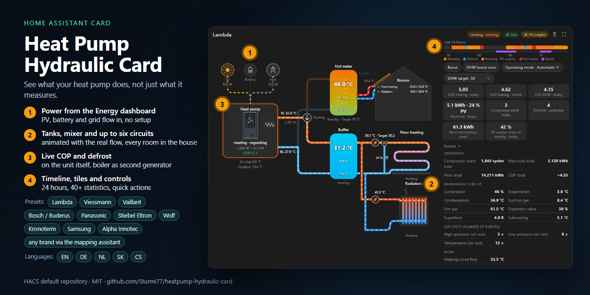
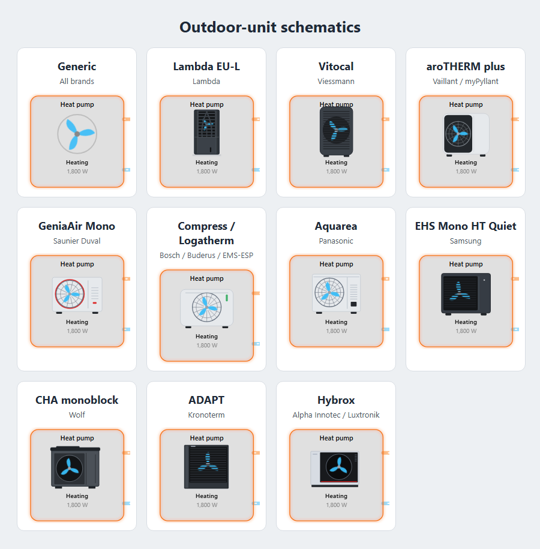

# Heat Pump Hydraulic Card

[](https://www.hacs.xyz/docs/use/repositories/dashboard/#search-repositories)
[](LICENSE)
[](https://github.com/Sturmi77/heatpump-hydraulic-card/actions/workflows/validate.yml)
[](https://github.com/Sturmi77/heatpump-hydraulic-card/releases)

[](https://my.home-assistant.io/redirect/hacs_repository/?owner=Sturmi77&repository=heatpump-hydraulic-card&category=plugin)



An **animated hydraulic schematic** for heat pumps in Home Assistant: air, ground (brine) and groundwater sources.

It shows electricity flowing from **PV, battery and grid** into the heat pump, the **diverter valve** switching between hot water and heating, colour-coded **tanks**, the **heating circuits** and your rooms. Animation speed follows the real flow rate. The core is vendor-neutral, and **presets** make it zero-config for popular heat pumps ([supported heat pumps](#supported-heat-pumps)).

**[Try the live demo](https://sturmi77.github.io/heatpump-hydraulic-card/demo/)**: every preset in heating, hot water, defrost and standby, the automatic/night/contrast card themes, English, German and an example custom Dutch translation, with the matching card configuration. Runs in the browser with simulated data, no Home Assistant needed.

## Getting started

1. **Install** the card through HACS: search for **Heat Pump Hydraulic Card**, download it and reload the browser ([details](#installation)).
2. **Add the card**: edit a dashboard, *Add card*, pick **Heat Pump Hydraulic Card**. It looks for a supported integration and fills in the preset; without one it shows a short start hint.
3. **Check the preset** in the card editor: the preset field says *Detected* and how many entities it found. If no supported preset is detected, select the heat-pump device in the mapping assistant, review its conservative proposals, or map your entities yourself ([any other heat pump](#any-other-heat-pump)).
4. **Fix what the editor reports**: *Check these fields* lists entities that do not fit their field (a temperature as the valve, a counter as the heater, the same sensor in two places), *Missing in the card* lists what the card cannot show without an entity, and entities the preset would use but that are disabled in Home Assistant. The most important fields come first in each group; the rest are under *More fields*.
5. **Something looks wrong?** Look up the symptom under [Troubleshooting](#troubleshooting). Still stuck: copy the diagnostic report (document button on the card), check it for private names and paste it into a [preset feedback issue](https://github.com/Sturmi77/heatpump-hydraulic-card/issues/new?template=preset_feedback.yml).


## Supported heat pumps

| Preset | Brands / models | Integration | Outdoor-unit schematic | Status |
|---|---|---|---|---|
| [`lambda`](docs/presets/lambda.md) | **Lambda** (EU-L series) | [lambda_heat_pumps](https://github.com/GuidoJeuken-6512/lambda_heat_pumps) (HACS) | Lambda EU-L | tested on a real installation |
| [`heishamon`](docs/presets/heishamon.md) | **Panasonic** Aquarea (H, J, K, L generation; monoblock, split, all-in-one) | [HeishaMon](https://github.com/heishamon/HeishaMon) + [heishamon-homeassistant](https://github.com/kamaradclimber/heishamon-homeassistant) (HACS) | Panasonic Aquarea | confirmed on a real installation |
| [`kronoterm`](docs/presets/kronoterm.md) | **Kronoterm** (ADAPT, ETERA, VERSI, WPLV …) | [Kronoterm](https://github.com/Favio25/Kronoterm-homeassistant) (HACS), Cloud API or Modbus | Kronoterm ADAPT (air units) | Cloud API confirmed on a real installation; Modbus from the integration source |
| [`vicare`](docs/presets/vicare.md) | **Viessmann** (Vitocal) | [ViCare](https://www.home-assistant.io/integrations/vicare/) (core) | Viessmann Vitocal 250-A | untested |
| [`open3e`](docs/presets/open3e.md) | **Viessmann** (Vitocal) | [Open3E](https://github.com/MojoOli/open3e-ha) (HACS, MQTT) | Viessmann Vitocal 250-A | confirmed on a real installation (two heating circuits) |
| [`vaillant`](docs/presets/vaillant.md) | **Vaillant** (aroTHERM, aroTHERM plus), **Saunier Duval**, **Bulex**, **Glow-worm**, **DemirDöküm** | [myPyllant](https://github.com/signalkraft/mypyllant-component) (HACS) | Vaillant aroTHERM plus by default; Saunier Duval GeniaAir Mono by manual override | confirmed on one aroTHERM plus installation |
| [`emsesp`](docs/presets/emsesp.md) | **Bosch**, **Buderus**, **Junkers**, **Nefit**, **Worcester**, **Sieger**, **elm.leblanc**, **iVT** – EMS/EMS+ heat pumps such as Buderus Logatherm WLW, Bosch Compress, Nefit EnviLine | [EMS-ESP](https://github.com/emsesp/EMS-ESP32) gateway (MQTT discovery) | Bosch Compress 5800i/6800i AW | confirmed on a Buderus Logatherm WLW186i installation |
| [`bosch_buderus_heating`](docs/presets/bosch-buderus-home-comfort.md) | **Bosch**, **Buderus** heat pumps in the Home Comfort app (PointT cloud, for example with an MX400 gateway) | [Bosch/Buderus Home Comfort](https://github.com/SoftwareSchmied/ha-bosch-buderus-heating) (HACS, `bosch_buderus_heating`) | Bosch Compress 5800i/6800i AW | untested (mapping checked against a manual configuration on one installation) |
| [`ebusd`](docs/presets/ebusd.md) | **Vaillant** aroTHERM / aroTHERM plus (HMU) with a VWZ hydraulic station and sensoCOMFORT / multiMATIC controller | [ebusd](https://github.com/john30/ebusd) with Home Assistant MQTT discovery | Vaillant aroTHERM plus | mapped from and checked live on one real installation (aroTHERM plus cascade, two circuits) |
| [`wolf`](docs/presets/wolf.md) | **Wolf** air/water heat pumps (CHA monoblock) with a WOLF Link gateway | [Wolf SmartSet Service](https://www.home-assistant.io/integrations/wolflink/) (core, `wolflink`) or [Wolf SmartSet (read/write)](https://github.com/tibuntu/homeassistant-wolf-smartset) (HACS, `wolf_smartset`) | Wolf CHA | `wolf_smartset` confirmed on a real installation (CHA); `wolflink` from the entity states of the same installation |
| [`luxtronik`](docs/presets/luxtronik.md) | **Alpha Innotec**, **Novelan**, **Roth**, **Siemens**, **Elco**, **Buderus**, **Nibe**, **Wolf** heat pumps with a Luxtronik controller | [Luxtronik](https://github.com/BenPru/luxtronik) (HACS, `luxtronik2`) | Alpha Innotec Hybrox (air), loop symbol with `source_type` | confirmed on one water-to-water installation; air and brine reports welcome |
| [`stiebel_isg`](docs/presets/stiebel-isg.md) | **Stiebel Eltron** (WPM 3, WPM 3i, WPMsystem, LWZ) and **Tecalor** heat pumps with an ISG | [Stiebel Eltron ISG](https://github.com/pail23/stiebel_eltron_isg_component) (HACS, `stiebel_eltron_isg`) | Stiebel Eltron WPL-A (air), loop symbol with `source_type` | confirmed on a WPMsystem; WPM 3, WPM 3i and LWZ from the integration source |
| [`samsung`](docs/presets/samsung.md) | **Samsung** EHS (Mono, Split, TDM) on the NASA bus | [esphome-samsung-nasa](https://github.com/Beormund/esphome-samsung-nasa) (ESPHome) | Samsung EHS Mono HT Quiet | tested on a real installation |

> [!NOTE]
> Presets marked *untested* are built from the source code of their integration and checked with simulated data. Please report whether they work on your installation: [preset feedback form](https://github.com/Sturmi77/heatpump-hydraulic-card/issues/new?template=preset_feedback.yml), with the diagnostic report after reviewing its entity ids for private names. Other heat pumps work with your own entity mapping ([any other heat pump](#any-other-heat-pump)).

## Current status

The current release is **[0.15.0](https://github.com/Sturmi77/heatpump-hydraulic-card/releases/tag/v0.15.0)**: a guided start, plausibility checks and filtered entity pickers in the editor, a diagnostic report that explains the detection, an outdoor-unit drawing for every preset, Slovak and Czech, and the Open3E preset confirmed on a real installation. What changed in each release is in the [release notes](https://github.com/Sturmi77/heatpump-hydraulic-card/releases) and the [changelog](CHANGELOG.md), the plan for the next releases in the [development plan](docs/ROADMAP.md). Reports from real installations are the most useful help right now, above all for the presets marked *untested*; please use the [tester issue](https://github.com/Sturmi77/heatpump-hydraulic-card/issues/1) or the [preset feedback form](https://github.com/Sturmi77/heatpump-hydraulic-card/issues/new?template=preset_feedback.yml).

## Features

- **Power sources:** PV, battery and grid flowing into the heat pump, taken from the **Energy dashboard** or your own sensors.
- **Heat pump:** mode and status, electrical power, heat output and live COP; the fan and pumps follow the compressor modulation, defrost shows a snowflake. A simplified, logo-free outdoor-unit drawing for 11 brand families (`unit_style`).
- **Heat source:** air, ground (brine loop) or groundwater (`source_type`), with source temperatures, flow rate and pressure thresholds.
- **Diverter valve and tanks:** hot water or heating, colour-coded tanks with up to three sensors, heater rods, an optional second heat generator in series, a series buffer, a combined storage (`storage`) and fresh-water stations or tank in tank (`dhw_type`).
- **Heating circuits:** up to six (`hc_count`) with underfloor, panel or column radiators, flow and target, room temperatures and the house.
- **Statistics and timeline:** tiles from a catalog of more than 40 values per period (today to total, from the long-term statistics where needed), cost with fixed or dynamic prices, and a 24-hour timeline of the operating mode.
- **Details and controls:** a details drawer with operating hours, counters and the refrigerant circuit; quick controls for switches, buttons, selects and numbers on the card.
- **Editor:** detects the integration, fills in the preset, shows the most important fields first and checks every mapping (wrong unit, wrong field, disabled entities). A local **diagnostic report** for support; nothing is uploaded.
- **Layouts and look:** default, compact, wide and wall display, full screen, card themes, and every colour as a CSS variable (`--hfc-*`).
- **Accessible:** keyboard operation with a visible focus frame, screen-reader labels, and `prefers-reduced-motion` is respected.
- **Languages:** English, German, Slovak and Czech built in; your own texts or languages with `texts`.
- **Only what you have:** parts without entities (buffer, tank, power sources, house) are simply not drawn.

| Viessmann preset, radiators | Vaillant preset, DHW run | Lambda zero-config, DHW run |
|---|---|---|
|  |  |  |

| Details drawer and quick controls | Ground source, two circuits, heater rod | EMS-ESP preset (Buderus) | HeishaMon preset (Panasonic), radiators | Other brand, minimal setup | Dark theme |
|---|---|---|---|---|---|
|  |  |  |  |  |  |

| Live on a real Lambda installation |
|---|
|  |


### Outdoor-unit style coverage



| `unit_style` | Schematic based on | Brands / families covered | Automatic selection |
|---|---|---|---|
| `generic` | Neutral fan symbol | Any air-source heat pump | Fallback without a known style; ground and groundwater sources show their loop symbol instead |
| `lambda` | Lambda EU-L | Lambda | `preset: lambda` |
| `viessmann` | Viessmann Vitocal 250-A | Viessmann Vitocal | `preset: vicare`, `preset: open3e` |
| `vaillant` | Vaillant aroTHERM plus | Vaillant; default fallback for the shared myPyllant brands | `preset: vaillant` |
| `saunier` | Saunier Duval GeniaAir Mono | Saunier Duval | Manual override because myPyllant does not identify the brand reliably |
| `bosch` | Bosch Compress 5800i/6800i AW | Bosch, Buderus, Junkers, Nefit, Worcester, Sieger, elm.leblanc and iVT through EMS-ESP; Bosch and Buderus through Home Comfort | `preset: emsesp`, `preset: bosch_buderus_heating` |
| `panasonic` | Panasonic Aquarea | Panasonic Aquarea; with `unit_size: large` the tall unit with two fans (T-CAP, 12 and 16 kW, H generation from 9 kW) | `preset: heishamon`, size from the model HeishaMon reports |
| `samsung` | Samsung EHS Mono HT Quiet | Samsung EHS Mono / Mono HT Quiet | `preset: samsung` |
| `wolf` | Wolf CHA monoblock | Wolf CHA-07/10 and CHA-16/20 (same proportions) | `preset: wolf` |
| `kronoterm` | Kronoterm ADAPT | Kronoterm ADAPT and ADAPT 2 air/water units (louvred front); brine and water units keep the loop symbol | `preset: kronoterm` |
| `alpha_innotec` | Alpha Innotec Hybrox | Alpha Innotec air units with a Luxtronik controller; Novelan, Roth, Siemens, Elco and the other Luxtronik brands share the controller, not the casing | `preset: luxtronik` (air units) |
| `stiebel` | Stiebel Eltron WPL-A | Stiebel Eltron WPL-A and comparable Tecalor air units with a WPM controller; LWZ integral units use `generic` | `preset: stiebel_isg` (air units) |

These are deliberately simplified original drawings without manufacturer logos. Related brands can share an integration even when their enclosures differ; set `unit_style` explicitly whenever the automatic family drawing does not match the installed unit.

| Keyboard focus |
|---|
|  |

## Installation

### HACS (recommended)

1. Open **HACS** in Home Assistant.
2. Search for **Heat Pump Hydraulic Card**. If needed, filter the repository type to **Dashboard**.
3. Open the repository, select **Download**, keep the newest version selected and reload the browser afterwards.

The **Open in HACS** button above opens the repository directly.

#### Custom repository fallback

If the standard HACS entry is not available in your installation, open HACS → ⋮ → **Custom repositories**, add `https://github.com/Sturmi77/heatpump-hydraulic-card` as type **Dashboard**, then install **Heat Pump Hydraulic Card** and reload the browser.

### Upgrading an installation from before the rename

The repository was called `heatpump-flow-card` until version 0.9.3. If you installed the card under that name, HACS keeps its old folder `/config/www/community/heatpump-flow-card/` and does **not** change the dashboard resource by itself. The new files then land next to the old ones, while the resource still loads the old file. You keep running an old version, and the card editor and new options are missing. Do the following once:

1. Open **HACS**, find **Heat Pump Hydraulic Card** (it is listed under the new name, with an old version number) and choose ⋮ → **Remove**. Remove does **not** reliably delete the old folder: check whether `/config/www/community/heatpump-flow-card/` still exists (File editor, Studio Code Server, Samba or SSH) and delete it if it does.
2. Open *Settings → Dashboards → ⋮ → Resources*. Delete every entry whose address contains `heatpump-flow-card`. If you manage resources in YAML, remove the line there.
3. In HACS, search for **Heat Pump Hydraulic Card** again, select **Download** and keep the newest version selected.
4. Check *Settings → Dashboards → ⋮ → Resources*: there must be exactly one entry for the card, `/hacsfiles/heatpump-hydraulic-card/heatpump-hydraulic-card.js`, type **JavaScript module**. If HACS did not add it, add it yourself.
5. Reload the browser with a hard refresh (Ctrl+F5, or clear the cache in the companion app).

From 0.15 on, the card notices when an older copy of itself was loaded first: it writes a warning to the browser console and shows a Home Assistant notification once per browser session, and its diagnostic report lists every script of the card on the page.

Your dashboards need no change: `type: custom:heatpump-flow-card` keeps working, and `type: custom:heatpump-hydraulic-card` is the same card under its own, unique name (see [Other cards with the same name](#other-cards-with-the-same-name)). To check what you are running, open `/hacsfiles/heatpump-hydraulic-card/heatpump-hydraulic-card.js` in the browser and look for `HFC_VERSION` near the top of the file. The version that HACS lists is the installed one, not necessarily the one your browser runs: the browser console line `HEATPUMP-FLOW-CARD x.y.z` and the "Loaded from" line of the card's diagnostic report show what is actually loaded.

If you installed the card manually as `/local/heatpump-flow-card.js`, replace the file by `dist/heatpump-hydraulic-card.js` from the latest release and change the resource address to match.

### Manual
Copy `dist/heatpump-hydraulic-card.js` to `/config/www/` and add `/local/heatpump-hydraulic-card.js` as a JavaScript module under *Settings → Dashboards → Resources*.

### Other cards with the same name
Several cards on GitHub are called "Heatpump Flow Card" and register the same element name, `heatpump-flow-card`. A browser keeps only the first definition, so with two of them installed the one that loads first answers to `type: custom:heatpump-flow-card`, and the other cannot be reached by that name.

This card therefore also registers under its own names, **Heat Pump Hydraulic Card** (`heatpump-hydraulic-card`):

```yaml
type: custom:heatpump-hydraulic-card   # instead of custom:heatpump-flow-card
preset: lambda
```

Both types are the same card with the same options. If you only use this card, nothing changes. If another card already owns the generic name, this card says so in the browser console and the card picker adds it with the type `custom:heatpump-hydraulic-card`; use that type in your configuration. In the card picker the card is always called "Heat Pump Hydraulic Card".

## Quick start

Added from the card picker, the card looks for a supported integration and fills in its preset. With two integrations for the same heat pump (myPyllant and ebusd, ViCare and Open3E) it takes the one that finds more live entities; the editor lets you switch. Without one it shows a short start hint instead of a drawing: open the card editor and pick a preset, or map your entities (see [Configuration](#configuration)).

| Your integration | Preset | Setup and details |
|---|---|---|
| lambda_heat_pumps | `lambda` | [Lambda](docs/presets/lambda.md) |
| ViCare | `vicare` | [Viessmann (ViCare)](docs/presets/vicare.md) |
| Open3E | `open3e` | [Viessmann (Open3E)](docs/presets/open3e.md) |
| myPyllant | `vaillant` | [Vaillant and related brands](docs/presets/vaillant.md) |
| EMS-ESP | `emsesp` | [Bosch, Buderus and related brands (EMS-ESP)](docs/presets/emsesp.md) |
| Bosch/Buderus Home Comfort | `bosch_buderus_heating` | [Bosch, Buderus (Home Comfort)](docs/presets/bosch-buderus-home-comfort.md) |
| HeishaMon | `heishamon` | [Panasonic Aquarea](docs/presets/heishamon.md) |
| esphome-samsung-nasa | `samsung` | [Samsung EHS](docs/presets/samsung.md) |
| ebusd | `ebusd` | [Vaillant aroTHERM (ebusd)](docs/presets/ebusd.md) |
| Kronoterm | `kronoterm` | [Kronoterm](docs/presets/kronoterm.md) |
| wolflink, wolf_smartset | `wolf` | [Wolf](docs/presets/wolf.md) |
| Luxtronik | `luxtronik` | [Luxtronik](docs/presets/luxtronik.md) |
| Stiebel Eltron ISG | `stiebel_isg` | [Stiebel Eltron ISG and Tecalor](docs/presets/stiebel-isg.md) |
| anything else | none | [Any other heat pump](#any-other-heat-pump) |

### Any other heat pump

When no supported preset is detected, the editor offers **Find entities on this heat pump device**. Pick the Home Assistant device, review every proposed field and select only the mappings you want to save. Nothing is written merely by choosing a device. A field is omitted when several entities match, because an empty mapping is safer than a guessed one.

The assistant uses this small exact naming table. It also checks that the entity's unit, device class and domain fit the target field. Underscores and punctuation in entity ids are normalized (`heat_pump_flow_temperature` → `heat pump flow temperature`), but measurement qualifiers are never discarded: `thermal_power` does not become `power`. It does not use fuzzy matching.

| Field | Exact English names | Exact German names |
|---|---|---|
| Flow | heat pump flow temperature, flow temperature, supply temperature, flow, supply | WP Vorlauf, Vorlauf, Vorlauftemperatur |
| Return | heat pump return temperature, return temperature | WP Rücklauf, Rücklauf, Rücklauftemperatur (also `ruecklauf`) |
| Electrical power | heat pump electrical power, electrical power, power consumption, input power, power | WP Leistung, Leistungsaufnahme, Leistung |
| Operating mode | heat pump operating mode, operating mode, operation mode, HP mode | WP Betriebsart, Betriebsart, Betriebsmodus |
| Compressor | compressor running, compressor frequency, compressor speed, compressor | WP Verdichter, Verdichter Status, Verdichterfrequenz, Verdichterdrehzahl, Verdichter |
| Diverter valve | diverter valve, three way valve, 3 way valve, DHW valve | WP Umschaltventil, Umschaltventil, Dreiwegeventil, 3 Wege Ventil, WW Ventil |
| Hot-water temperature | domestic hot water temperature, hot water temperature, DHW temperature | Warmwasser Temperatur, Warmwassertemperatur, WW Temperatur |
| Outdoor temperature | outdoor temperature, outside temperature, ambient temperature | Außentemperatur, Außen Temperatur, Außen |

Afterwards, translate the raw mode states to the card's normalized modes when necessary:
```yaml
type: custom:heatpump-flow-card
title: Heat pump
entities:
  mode: sensor.hp_operating_mode
  flow: sensor.hp_flow_temperature
  return: sensor.hp_return_temperature
  power: sensor.hp_power
  dhw_top: sensor.dhw_temperature
  outdoor: sensor.outdoor_temperature
  hc_pump: binary_sensor.heating_circuit_pump
mode_map:
  Heating: heating
  Hot water: dhw
  Defrost: defrost
  Standby: idle
```
Normalized modes: `heating`, `dhw`, `cooling`, `defrost`, `idle`, `blocked`, `frost`, `circulate`, `off` (plus `legionella`, `trailing` for the DHW tank). If your heat pump has a diverter-valve sensor, use `valve` (binary, on = DHW) instead of a DHW mode.

## Troubleshooting

The card editor checks the mapped entities and names most of these cases itself (*Check these fields*); the [diagnostic report](#diagnostic-report) lists the same checks and where each entity comes from (`[preset]` or `[own]`).

| Symptom | Usual cause | Fix |
|---|---|---|
| The card shows only a start hint ("pick a preset") | No supported heat pump integration was found. | Pick the preset in the editor, or map your entities ([any other heat pump](#any-other-heat-pump)). |
| The editor says "Not found" at the preset | The integration is missing, has another prefix or reports no entities yet. | Check the integration, set `prefix`, or pick the other preset the editor lists as detected. The report's *Detection* section says what the preset looked for ([diagnostic report](#diagnostic-report)). |
| Power, heat or another value is missing although the integration has it | The entity is disabled in Home Assistant (Luxtronik disables power and heat output by default). | The editor names disabled entities the preset would use: enable them under *Settings → Devices & services → Entities* ([Luxtronik](docs/presets/luxtronik.md)). |
| No live COP | No electrical power, or neither heat output nor flow rate. | Map `power` and `heat`, or `volume` for an estimated heat output ([where the numbers come from](#where-the-numbers-come-from)). |
| PV, battery or grid flows are missing | The Energy dashboard has energy counters but no power sensors, or the heat pump has no `power`. | Add the power sensors in the Energy dashboard, or set `pv`, `battery`, `grid` yourself ([where the numbers come from](#where-the-numbers-come-from)). |
| Hot water shown while heating, or the other way round | The valve reports 1 or a text for heating. | Set the valve states in the editor (*Advanced*), saved as `valve_map` ([configuration](#configuration)). |
| No hot-water animation | `valve` maps a temperature, or the preset finds no hot-water signal. | Map the three-way valve or the hot-water state; the editor flags a temperature as the valve. |
| Heater rod always red | `heater` or `dhw_heater` maps a counter (starts, hours) or a one-time-charge switch. | Map the on/off state or the power (W) of the heater, or clear the field. |
| The primary pump runs while the compressor is off | `volume` maps the heating-circuit flow rate. | Map the flow rate of the heat pump loop; the circuit's flow rate goes to `hc_volume`. |
| A tank shows the heat pump flow temperature | `buffer_top` or `dhw_top` maps the flow sensor. | Map the tank sensor, or clear the field. |
| The room temperature shows a word | `room` maps a `select` or a text sensor. | Map a temperature sensor or the `climate` entity. |
| "Starts today" or "Energy today" is far too high | A lifetime counter is mapped to the daily field. | Map the daily counter, or the total counter to `starts_total` / `energy_total`; tiles take daily values from the long-term statistics ([stat tiles](#stat-tiles)). |
| Values jump or update slowly | Fields mixed from two integrations (local and cloud), or two entity sets of the same integration. | Take the fields from the preset's integration; the report marks entities of another integration as `[own · <integration>]`. |
| A heating circuit is missing | `hc_count` is lower than the number of circuits. | Raise *Heating circuits* in the editor ([configuration](#configuration)). |
| The card looks like an old version, options are missing | An old copy of the card is still loaded (the resource from before the rename). | Delete the old resource and folder ([upgrading](#upgrading-an-installation-from-before-the-rename)); the card shows a notification when it notices this. |

## Configuration

Everything can be set in the **UI editor**. With a preset, the editor shows whether the integration was detected and fills in every entity the preset found ("Found by the preset"). Only your changes are saved: pick another entity to override one, clear a field to hide it (saved as `null`).

| Option | Description |
|---|---|
| `preset` | `lambda`, `vicare`, `vaillant`, `emsesp`, `bosch_buderus_heating`, `heishamon`, `wolf`, `kronoterm`, `ebusd`, `open3e`, `luxtronik`, `stiebel_isg`, `samsung` or omit. Fills entities, mode maps and error sensors. |
| `prefix` | Preset prefix (Lambda device name, Vaillant home slug, EMS-ESP instance prefix, HeishaMon MQTT prefix, Wolf device slug (`wolflink` only), ebusd topic prefix). Omit for auto-detection, `""` for unprefixed Lambda ids. |
| `device` | Device id: restricts preset detection to one device (several heat pumps of the same brand). |
| `index` | Unit numbers for presets: `{hp, dhw, buffer, hc}` (default 1; Vaillant counts from 0). |
| `hc_type` | Circuit 1: `underfloor` (default), `radiator` (panel radiator) or `column` (column radiator). |
| `hc_count` | Number of heating circuits, 1 (default) to 6. Presets fill the further circuits with the next circuit numbers. The schematic grows by one row per circuit. |
| `hc2_type` to `hc6_type` | Emitter of circuits 2 to 6 (default `underfloor`). |
| `hc_name`, `hc2_name` to `hc6_name` | Circuit titles (default "Heating circuit 1", "Heating circuit 2", …). |
| `hc_return_label` | Show the return temperature of each heating circuit under its return pipe, from `hc_return`, `hc2_return` … (default `false`). Only the circuit's own return sensor is shown; narrow cards hide the label. The prefix `RL` is the text `return_short`. |
| `narrow_values` | Keep configured buffer middle/bottom values and circuit-return labels visible below 500 px (default `false`). Other secondary labels stay hidden to preserve the responsive layout. |
| `buffer_values` | `default`: large top buffer temperature with smaller middle/bottom values. `equal`: all configured buffer temperatures use the same size and are distributed evenly over the tank. |
| `source_type` | `air` (default), `brine` (ground loop) or `water` (groundwater wells). |
| `primary_pump` | Draw the heat pump's own primary pump on the flow pipe next to the heat pump block, instead of a pump in the heating circuit. It turns while the flow rate is above 0, else with the heating or hot-water loop, and slowly while the heat pump only circulates water. A single direct circuit without a `hc_pump` sensor then shows no pump of its own. The default comes from the preset: on for HeishaMon, Samsung and Kronoterm, off otherwise. Also in the editor. |
| `storage` | `separate` (default): a hot-water tank and, with its sensors, a buffer. `combined`: one combined (layered) storage, drawn as a tall tank with the hot-water zone on top and the heating zone below, also without sensors (also in the editor). The storage keys keep their meaning as heights from top to bottom: `dhw_top`, `dhw_middle`, `dhw_bottom` in the hot-water zone, `buffer_top`, `buffer_middle`, `buffer_bottom` in the heating zone; the tank colour runs over every sensor at its height (a sensor without a value takes the colour of the nearest one). The diverter valve charges the top zone for hot water and the middle for heating, cooling runs through the heating zone as well; the heating circuits draw from the heating zone like from a buffer. `dhw_heater` and `buffer_heater` sit in their zone, solar thermal enters the hot-water zone. Not together with `series_buffer`. Presets never set it, because they cannot tell one tank from two. |
| `dhw_type` | How the tap water is heated (also in the editor): `coil` (default, a heat-exchanger coil in the tank), `fresh_water` (a fresh-water station: with `storage: combined` drawn beside the hot-water zone; with separate storages and a parallel buffer it replaces the hot-water tank and stands on the buffer, without a diverter valve, and hot-water operation heats the buffer; `dhw_top` is then the outlet temperature, solar thermal is not drawn because it needs a hot-water tank, and without a buffer the tank with its coil stays) or `tank_in_tank` (an inner tank in the hot-water zone, only with `storage: combined`). The tap side is not drawn and the station pipes do not animate. With a fresh-water station on the buffer the `dhw_loss` tile is not offered; with a combined storage it needs the pump of every heating circuit (`hc_pump`, `hc2_pump` …) and leaves out every window in which one of them runs. |
| `series_buffer` | `true` draws a series buffer in the return of the heating circuits with a 3-way bypass valve (default `false`, also in the editor). Normally the circuit return runs through the buffer. While `bypass_valve` is on, or without that entity while the heat pump defrosts, the flow runs straight into the buffer and the circuits stand still, so the heat pump defrosts from the buffer water. The buffer needs no sensors; a parallel buffer with its own sensors (`buffer_top`, `buffer_mode`) wins. |
| `series_bypass` | `false` for a series buffer without a bypass valve (default `true`, in the editor only with `series_buffer`): the card draws no valve, the circuit return always runs through the buffer and the circuits keep running in defrost. |
| `title` | Card title (default: "Heat pump" / "Wärmepumpe"). |
| `language` | `auto` (default, follows the Home Assistant language), `en`, `de`, another built-in language ([docs/TRANSLATING.md](docs/TRANSLATING.md)) or a lowercase language code defined in `texts`. |
| `texts` | YAML-only nested language map for custom labels/translations. Missing labels fall back to English; see [Custom texts and languages](#custom-texts-and-languages). |
| `theme` | `auto` (default, follows Home Assistant), `night` or `contrast`. |
| `fullscreen` | Show the full-screen button (default `true`). Set to `false` to hide it. |
| `power_threshold` | Counts as running above this electrical power in W (default 100). |
| `power_sources` | `auto` (default): PV / battery / grid from the Energy dashboard unless `pv`, `battery` or `grid` are set. `manual`: only your own sensors. |
| `entities` | Entity overrides (see below). `null` removes a preset entity. A list of entities for `power`, `heat`, `pv`, `battery` or `grid` shows the sum of their values. |
| `mode_map`, `dhw_mode_map`, `buffer_mode_map`, `hc_mode_map` | Raw state → normalized mode, merged over the preset. |
| `valve_map` | Raw state of the `valve` entity → `dhw` or `heating`, for a valve that does not follow "on = hot water", for example a zone valve with `1` for heating and `0` for hot water: `valve_map: { 0: dhw, 1: heating }`. States that are not in the map keep the default reading (`on`, `Tank`, `DHW` … mean hot water). The map also applies to the timeline when it is drawn from the compressor and the valve. The values are accepted in any case and as `heat`, `hot water` or `hot_water` too. In the visual editor the map is two fields under "Advanced", shown when a valve entity is mapped: "Valve states for hot water" and "Valve states for heating", each a comma-separated list of raw states; the helper text shows the current state of the valve. A map written in YAML stays as it is when the card is saved in the editor unless the fields are changed. When the valve is a sensor that reports a number and there is no map, the editor warns that 1 is read as hot water. |
| `running_states` | Raw `status` values that count as compressor running. |
| `errors` | List of error-code sensors. A number ≠ 0 or state `on` shows the error chip. `unknown`, `unavailable`, `off`, `0` and empty do not. Other text is ignored unless `error_ok` is set. |
| `error_ok` | Text states that mean "no error", for example `["No Error", "OK"]` (case-insensitive). With this list, any other known non-numeric text from an error entity shows the chip. Presets may provide this list. |
| `badges` | `[{entity, label}]` chips shown while the entity is on; each can carry `tap_action`, `hold_action` and `double_tap_action`. |
| `program_map` | Raw state of the program entity → `eco`, `night`, `party`, `holiday` or `none`, merged over the preset. Without an entry the card recognises common words (eco, reduced, setback, absenk…, party, holiday, urlaub …). |
| `compressor_speed_max` | Hz or rpm that count as full speed when `compressor_speed` is not a percentage (default: 100 Hz, 6000 rpm). Sets the pace of the animation. |
| `animations` | `auto` (default, respects reduced motion), `always` or `off`. |
| `flow_speed` | Multiplier for all animation speeds, from `0.2` to `3` (default `1`). |
| `source_spread` | Show `source_in − source_out` on a running ground/groundwater loop (default `true`). |
| `brine_pressure_min`, `brine_pressure_crit`, `brine_pressure_max` | Optional brine-pressure thresholds in bar. Below `crit` is critical; below `min` or above `max` is a warning. |
| `hc_pressure_min`, `hc_pressure_crit`, `hc_pressure_max` | Optional heating-pressure thresholds in bar, with the same warning/critical logic. |
| `unit_style` | Drawing of the outdoor unit: `auto` (default, uses the preset style), `generic`, `lambda`, `viessmann`, `vaillant`, `saunier`, `bosch`, `panasonic`, `samsung`, `wolf`, `kronoterm`, `alpha_innotec` or `stiebel`. Ground and groundwater sources keep their loop symbol. See [Outdoor-unit style coverage](#outdoor-unit-style-coverage). |
| `unit_size` | Vaillant aroTHERM plus class: `small` (3.5 and 5.5 kW, one fan, low), `medium` (7.5 kW, one fan, default) or `large` (10.5 and 12.5 kW, two fans). Panasonic: `medium` (one fan) or `large` (two fans: T-CAP, 12 and 16 kW, H generation from 9 kW); left out, the HeishaMon preset takes it from the model the heat pump reports (`…_main_heat_pump_model`). |
| `timeline` | `true` shows a strip with the operating mode of the last hours under the schematic (needs the `mode` entity, or the `compressor` and optionally the `valve`, and the Home Assistant history). |
| `timeline_hours` | Length of the timeline in hours, 3 to 72 (default 24). |
| `timeline_marks` | `true` adds a lane under the timeline for every badge, showing when it was on (for example Boost). A list of entities or `{ entity, label }` entries does the same for other switches, inputs and sensors with an on/off state. Needs the Home Assistant history. |
| `layout` | `default`, `compact` (tighter spacing for narrow columns), `wide` (controls, tiles and details beside the schematic when the card is at least 760 px wide) or `wall` (wide, with large type; the quick controls and the details toggle fade out until the card is touched). |
| `wall_timeout` | Seconds the controls of the `wall` layout stay visible after the last touch or mouse move (default 10, `0` = always visible). |
| `actions` | Tap, hold and double-tap actions per element, keyed by entity key: `{dhw_top: {tap_action: {…}}}`. See [Layout, actions and colours](#layout-actions-and-colours). |
| `controls` | Quick controls: list of entity ids or `{entity, name}`. Supported: `switch`, `input_boolean`, `light`, `fan`, `automation` (toggle), `button`, `input_button`, `script`, `scene` (press), `select`, `input_select`, `water_heater`, `climate` (dropdown), `number`, `input_number` (input). |
| `details` | Extra rows in the details drawer: list of entity ids or `{entity, name, unit, decimals}`. |
| `details_open` | Open the details drawer by default (default `false`). |
| `tiles` | Your own tile selection, in this order: catalog keys with an optional period (`cop_heating`, `cop_heating:month`, `{key, period, name, decimals, unit}`) and free entities (`{entity, name, unit, decimals}`). Every tile can carry `tap_action`, `hold_action` and `double_tap_action`. Without `tiles` the default tiles are shown; `tiles: []` hides the row. See [Stat tiles](#stat-tiles). |
| `price` | Electricity price per kWh for the `cost` tile: a number or an entity (e.g. a dynamic tariff; ct/kWh and per-MWh prices are converted). `currency` overrides the currency from the HA settings. |
| `stats` | Extra tiles `[{entity, name, unit, decimals}]`, added after the default tiles or after `tiles`; also with `tap_action`, `hold_action`, `double_tap_action`. |

**Entity keys:**
- **Heat pump:** `mode`, `status`, `compressor` (binary, or frequency/speed > 0), `fan_speed` (rpm, or binary: the fan of the unit drawing turns while it is above 0 or on, and faster at a higher speed; without it the fan follows the running state), `defrost` (binary), `power` (W or kW), `heat` (kW or W), `flow`, `return`, `volume`, `source_volume`, `source_in`, `source_out`, `brine_pressure` (bar, kPa, Pa, hPa, MPa or psi), `outdoor`, `valve` (binary, or a state like `Tank`/`DHW`), `heater` (backup / inline heater), `pv_boost` (PV surplus mode: binary, or a power above 0, see below)
- **Boiler / second heat generator:** `boiler_state` (binary, a numeric level/power, or a common running state such as `running`, `heating` or `burner`), optional `boiler_power` (W or kW) and optional `boiler_flow` (°C). Setting any of these keys draws a separate boiler in series in the common flow before the existing diverter valve. The card distinguishes heat-pump-only, boiler-only and simultaneous operation; the valve still decides whether the common flow goes to heating or hot water. If `boiler_state` is omitted, `boiler_power > 0` is the running signal. This is separate from `heater`, the heat pump's backup/inline heater. Presets do not map boiler entities automatically.
- **Storage:** `dhw_top`, `dhw_middle`, `dhw_bottom`, `dhw_target`, `dhw_mode`, `circulation`, `dhw_loss_sensor` (optional plain sensor used only to fit the standby-loss slope), `dhw_heater`, `buffer_top`, `buffer_middle`, `buffer_bottom`, `buffer_mode`, `buffer_heater`, `bypass_valve` (series buffer: on = bypass, see `series_buffer`), `solar_collector`, `solar_pump` (needs the DHW tank). Without any hot-water key the card draws no tank: when the operating mode reports hot water, the heat pump shows "Hot water" and runs, but no pipe flows, because the card cannot show where the heat goes.
- A tank sensor colours the storage only from its measured height. If `dhw_top` is missing, the unmeasured upper zone stays neutral instead of copying a cooler middle or bottom sensor; this avoids suggesting that the whole tank is cold when useful hot water may remain above the highest sensor.
- **Heating circuit and house:** `hc_flow`, `hc_return`, `hc_setpoint`, `hc_mode`, `hc_pump`, `hc_volume`, `hc_curve_offset` (shift of the heating curve in K, see HeishaMon; also `hc2_` to `hc6_`), `hc_pressure` (bar, kPa, Pa, hPa, MPa or psi), `room`, `room_target`, `program` (eco, night, party, holiday)
- **Direct systems:** without a buffer and without circuit-specific temperature sensors, circuit 1 uses the heat pump's `flow` and `return` and remains connected in the schematic.
- **Thermostats as temperature sources:** a temperature key also takes a `climate` or `water_heater` entity. The card reads its `current_temperature`, and its target `temperature` for `dhw_target`, `room_target` and the `_setpoint` keys. One DHW thermostat can serve as `dhw_top` and `dhw_target`.
- **Circuits 2 to 6:** the same keys with `hc2_` to `hc6_` (`hc2_flow`, `hc6_pump`, …)
- **Room overview per circuit:** `room` / `room_target` belong to circuit 1; `hc2_room` to `hc6_room` and `hc2_room_target` to `hc6_room_target` add the other circuits, for example one room sensor per floor. With several circuits the house shows one row per circuit with its name, actual and target temperature. A blue, green or red dot marks whether the actual value is below, within or above 0.5 K of the target. Each row opens its room sensor (or the target without one); the status below each emitter remains reserved for its operating mode. With one circuit the familiar large room value in the house remains unchanged. Presets do not fill the additional circuit keys yet.
- **Heaters** (`heater`, `dhw_heater`, `buffer_heater`): binary or on/off, a power value (on above 0) or a stage number (1-3). These remain heater rods and are not the separate `boiler_*` heat generator.
- **PV surplus mode** (`pv_boost`): any heat pump or energy manager that raises the heating to take up PV surplus (a PV surplus switch, an SG Ready state turned into on/off, or a power such as the setpoint of the Lambda E-Manager) can feed it. The entity counts as active when it is on or reports a value above 0. The card then shows a "PV surplus" chip next to the mode, turns the heating periods of the timeline in which it was active into "Heating · PV surplus" (hatched), and offers the tile `pv_boost_share` (share of the heating time in PV surplus mode today, yesterday and this week, from the recorder history). The Lambda preset maps the E-Manager setpoint (`emgr_power_consumption_setpoint`) automatically; it needs the E-Manager in the integration. Example for another system: `entities: { pv_boost: binary_sensor.heat_pump_pv_mode }`.
- **Power sources:** `pv`, `battery`, `grid` – the heat pump's power from each source. Power sensors in W, kW and MW are converted to W. Energy counters in Wh, kWh or MWh cannot show a current flow and are rejected by the editor check. Optional: without own source sensors the card uses the Energy dashboard.
- **Sums:** `power`, `heat`, `pv`, `battery` and `grid` also accept a list of entities. The card adds the values of the members that report a number (W, kW and MW can be mixed); the first entity opens on tap and stands for the key in the editor warnings. Example: two meters for compressor and heater rod, `power: [sensor.heat_pump_meter_power, sensor.heater_meter_power]`.
- **Statistics:** `cop_heating_today`, `cop_dhw_today`, `energy_today`, `pv_share_today`, `starts_today`
- **Details, operation:** `hours`, `starts_total`, `aux_hours`, `energy_total`, `env_energy` (heat taken from air, ground or water), `heat_total`
- **Details, refrigerant circuit:** `compressor_speed`, `evap_temp`, `cond_temp`, `suction_temp`, `hot_gas`, `liquid_temp`, `low_pressure`, `high_pressure`, `eev`, `superheat`, `subcooling`
- **Details, cut-out counters:** `cutout_high_pressure`, `cutout_low_pressure`, `cutout_temperature`. These are cumulative **counts of cut-out events** from your integration, not pressures or temperatures. They appear in their own drawer section "Cut-outs (number of events)" as whole numbers with a times sign (for example "3 ×"), separate from the refrigerant circuit values above. No preset fills them yet; map them yourself until entity meaning and units are verified for an integration.

A house with one circuit per floor, each with a room sensor of its own:
```yaml
hc_count: 2
hc_name: Ground floor
hc2_name: Attic
entities:
  room: sensor.living_room_temperature   # circuit 1, shown in the house
  hc2_room: sensor.attic_temperature     # circuit 2, shown under its emitter
  hc2_room_target: sensor.attic_target   # optional
```

### Stat tiles
In the UI editor, switch on **Own tile selection**. The editor then offers only the tiles your installation can fill; drag them to sort. Enter an electricity price (a number or an entity) to get the cost tile. In YAML:

```yaml
price: sensor.epex_spot_price   # or a number, e.g. 0.30
tiles:
  - cop_heating               # without a period: today if possible, else the current value or the total
  - cop_heating:month
  - key: energy
    period: today
  - env_energy:month          # environmental energy from a total counter's long-term statistics
  - starts
  - defrosts:yesterday
  - cost:month                # electricity × price, currency from the HA settings
  - key: energy_heating
    period: month
    tap_action:               # any Home Assistant action; default: more-info
      action: navigate
      navigation_path: /energy
    hold_action:
      action: more-info
  - entity: sensor.my_value   # any entity as a tile
    name: My value
```

**Cost:** with a fixed price, cost = electricity of the period × price. With a price entity that has long-term statistics (`state_class: measurement`, true for most tariff sensors), the card bills every hour at that hour's mean price, from Home Assistant's long-term statistics. The current hour, which is not yet in the statistics, is billed at the current price. For the year the card uses daily values and for the total monthly values, so these are marked **≈**. A price entity without statistics is applied to the whole period at its current price, also marked **≈**. A tile can have its own `price` and `currency`. If your tariff sensor once changed its unit (for example from ct/kWh to €/kWh), its older statistics keep the old values and the cost for longer periods comes out too high. In that case, fix the statistics under Developer tools > Statistics.

**Actions:** a tap opens the more-info dialog of the tile's entity. `tap_action`, `hold_action` (500 ms) and `double_tap_action` accept every Home Assistant action (`more-info`, `navigate`, `url`, `toggle`, `perform-action`, `assist`, `none`, with `confirmation`). Tiles with their own name, entity, price or action are edited in YAML.

Periods: `now`, `today`, `yesterday`, `week`, `month`, `year`, `total`. A tile is only shown when the installation can fill it. Values come from, in this order:
1. the preset's own entity for that period (e.g. Lambda `hp1_heating_cop_monthly`)
2. for the default tiles' entities (`cop_heating_today` …): "today"
3. the change over the period from Home Assistant's **long-term statistics** of a total counter (needs `state_class: total_increasing`, true for most energy counters). This gives EMS-ESP and others "today", "this month" and so on, although they only report totals.
4. computed from other tiles, marked **≈**: COP = heat ÷ electricity, or without heat = (environmental energy + electricity) ÷ electricity; runtime per start = hours ÷ starts.

| Group | Tile keys |
|---|---|
| Efficiency | `cop_live`, `cop_heating`, `cop_dhw`, `cop_cooling`, `cop_total`, `spf` (year) |
| Electricity | `energy`, `energy_heating`, `energy_dhw`, `energy_cooling`, `energy_defrost`, `energy_standby`, `energy_aux` (heater) |
| Environmental energy | `env_energy` |
| Heat | `heat`, `heat_heating`, `heat_dhw`, `heat_cooling`, `heat_defrost` |
| Starts and runtime | `starts`, `cycles_heating`, `cycles_dhw`, `cycles_cooling`, `defrosts`, `hours`, `hours_per_start`, `load_classes`, `aux_hours`, `aux_starts` |
| Live | `spread`, `volume`, `heat_estimated`, `power`, `heat_live`, `compressor_speed`, `source_spread`, `outdoor`, `dhw_top`, `room`, `brine_pressure`, `hc_pressure`, `pv_share` |
| Other | `pv_production`, `solar_thermal` (ViCare), `cost`, `dhw_loss` (hot-water standby loss, K/h) |
| PV surplus | `pv_boost_share` (needs `pv_boost`; periods `today`, `yesterday`, `week`) |

What the presets provide:
- **Lambda:** COP heating/DHW/cooling per day, month, year and in total; electricity and heat per mode including defrost and standby; starts, heating/DHW/cooling cycles and defrosts per day and yesterday.
- **ViCare:** COP and SPF, electricity per day, week, month and year (total, heating, DHW, cooling), compressor hours, starts and load classes, heater rod hours and starts, PV and solar thermal yield.
- **EMS-ESP:** totals for electricity, heat, starts and hours per mode; other periods from long-term statistics.
- **HeishaMon:** heat and electricity per mode as current power, so the COP tiles work for "now"; operating hours and starts.
- **Samsung:** electricity, heat and COP today (template sensors of `example.yaml`) and in total; other periods from long-term statistics.
- **Vaillant:** daily electricity and heat for heating and DHW.
- **Kronoterm:** electricity today in total and per heating, DHW and heater (Cloud API); week, month and year from the electricity counter; COP total from the SCOP; heating, DHW and cooling compressor starts as totals.

### Layout, actions and colours
**Layout.** `layout: compact` reduces padding and type sizes for narrow dashboard columns. `layout: wide` shows the schematic on the left and controls, tiles and the details drawer on the right once the card is at least 760 px wide (below that it falls back to the normal stacked layout), which suits wall tablets. `layout: wall` is the wide layout with about 30 % larger type for reading from a distance. The quick controls and the details toggle are invisible and not clickable until a touch or mouse move wakes the card; after `wall_timeout` seconds (default 10) they fade out again and an open details drawer closes. A control in use, such as an open dropdown, keeps the card awake. All layouts are also in the editor.

**Animations.** `animations: auto` (default) respects the operating system's reduced-motion preference. Use `animations: always` to animate anyway or `animations: off` for a static schematic. `flow_speed` scales all movement from `0.2` to `3` (`1` is the default); sensor-driven fan, pump and flow differences are preserved. Both options are in the editor.

**Full screen.** The expand button opens the existing card instance in an overlay, so it does not duplicate entity subscriptions, history requests or control state. Close it with Escape, the close button or a click outside the card; keyboard focus stays inside the overlay and returns to the expand button afterwards. Set `fullscreen: false` to remove the button. The overlay follows viewport changes and safe areas on phones and tablets.

**Card theme.** `theme: auto` keeps the dashboard's Home Assistant theme and all `--hfc-*` overrides. `theme: night` dims fixed colours for dark rooms. `theme: contrast` uses stronger black/white surfaces, role colours, thicker pipes and more visible focus outlines. These are fixed per-card choices; automatic time- or entity-based switching is deliberately outside this option.

For ground and groundwater sources, the loop shows `ΔT` while the compressor runs when both `source_in` and `source_out` are available. Set `source_spread: false` to hide it; the source-spread tile remains available independently.

**Actions on elements.** Every element of the schematic shows an entity, and a tap opens its more-info dialog. To change that, give the entity key of the element (see "Entity keys") its own actions. They accept every Home Assistant action, the same as the tiles: `more-info`, `navigate`, `url`, `toggle`, `perform-action`, `assist`, `none`, with `confirmation`. A hold takes 500 ms.

```yaml
actions:
  dhw_top:                      # the hot water tank
    tap_action:
      action: navigate
      navigation_path: /lovelace/hot-water
    hold_action:
      action: more-info
  mode:                         # the heat pump block and the mode chip
    double_tap_action:
      action: perform-action
      perform_action: script.heat_pump_boost
badges:
  - entity: input_boolean.boost
    label: Boost
    tap_action:
      action: toggle
```

An action for a key the card has no entity for does nothing; the browser console says so. Actions are edited in YAML.

**Narrow cards.** The type size follows the width of the schematic, not the screen: below about 640 px the labels grow, below about 500 px (phones, narrow columns) they grow further and secondary labels (flow rates, tank bottom temperature, the VL / RL prefixes, valve and circulation labels, the hot water target line) are left out, so the important numbers stay readable. Set `narrow_values: true` to keep the configured buffer middle/bottom values and circuit-return labels; other collision protection remains active. Chip text takes the colour of your theme text, so it reads in light and dark themes.

**Colours.** The card draws with these CSS variables. Set them in a theme or per card with card-mod; without a value the default applies. The card keeps styles injected by card-mod across its initial setup and later configuration or entity-registry rebuilds.

| Variable | Default | Used for |
|---|---|---|
| `--hfc-heat` | `#f97316` | running heat pump, heating chip, heater rod, impeller, heat waves |
| `--hfc-hot` | `#dc2626` | hot water chip, error chip, second heater stage |
| `--hfc-cool` | `#38bdf8` | fan blades while running, groundwater |
| `--hfc-cool-strong` | `#0ea5e9` | snowflake, circulation pump |
| `--hfc-defrost` | `#7dd3fc` | flow pipe while defrosting or cooling |
| `--hfc-flow-cold`, `--hfc-flow-hot` | `#fb923c`, `#dc2626` | flow pipes, 25 to 55 °C |
| `--hfc-return-cold`, `--hfc-return-hot` | `#7dd3fc`, `#2563eb` | return pipes, 20 to 45 °C |
| `--hfc-tank-cold`, `--hfc-tank-cool`, `--hfc-tank-warm`, `--hfc-tank-hot` | `#3b82f6`, `#22d3ee`, `#f97316`, `#ef4444` | tank gradient in four steps, 20 to 58 °C |
| `--hfc-anthracite` | `#3b4148` | dark casings: Lambda unit, dark panel of the Vaillant unit |
| `--hfc-casing` | `#e6e9ec` | light casing of the Vaillant unit |
| `--hfc-pv`, `--hfc-battery`, `--hfc-grid` | `#f59e0b`, `#10b981`, `#94a3b8` | power sources and their flow lines |
| `--hfc-good` | `#16a34a` | live COP |
| `--hfc-badge` | `#a855f7` | badge chips |
| `--hfc-brine`, `--hfc-ground` | `#60a5fa`, `#a16207` | brine pipes, ground loop |
| `--hfc-flow-dash` | `rgba(255,255,255,.9)` | the moving dashes in the pipes |

```yaml
type: custom:heatpump-flow-card
preset: lambda
card_mod:
  style: |
    :host {
      --hfc-heat: #14b8a6;
      --hfc-tank-hot: #f43f5e;
    }
```

### Custom texts and languages

The built-in English and German text can be overridden or extended in YAML. Select the language with `language`; every omitted key falls back to English, so a translation can start small:

```yaml
type: custom:heatpump-flow-card
preset: lambda
language: nl
texts:
  nl:
    title: Warmtepomp
    modes:
      heating: Verwarming
    tiles:
      cop_heating: COP verwarming
```

Language codes must be lowercase (`nl`, `pt-br`). Values are treated as plain text and escaped before they are rendered. The stable key tree and placeholder rules are documented in [`docs/TEXTS.md`](docs/TEXTS.md). The visual editor preserves `texts`, but editing the nested map remains YAML-only, and the editor itself stays English or German.

Would you like your language built in for everybody, including the editor? Translations are welcome and can be partial: [docs/TRANSLATING.md](docs/TRANSLATING.md).

### Diagnostic report

The document button in the card header copies a plain-text diagnostic report to the clipboard. It includes the card and Home Assistant versions, language, resolved preset and prefix, layout/source choices, the hydraulic options (storage, hot-water preparation, series buffer, primary pump), what the preset detection looked for, the heat pump integrations in Home Assistant (names and entity counts only) and the presets that match, every entity mapping with its current state, unit and source (`[preset]`, `[own]`, or `[own · <integration>]` when it comes from another integration than the preset's), cleared and unmapped keys in one line each, the plausibility checks of the editor, the value maps (`valve_map`, `mode_map`, `dhw_mode_map`, `buffer_mode_map`, `hc_mode_map`, `program_map`) with their source (preset or configuration; a map placed under `entities` by mistake is named, because the card ignores it there), error sensors and quick controls. It does not include a registry or attribute dump and never sends data anywhere.

Entity ids can still contain room, person or installation names. Read the report and remove anything private before sharing it in an issue. The report is the preferred input for preset testing and bug reports because it shows both detected and missing mappings without requiring screenshots of Developer Tools.

### Keyboard and screen readers
The card works without a mouse or touch screen.
- **Tab** goes through the header chips, then the schematic, the quick controls, the tiles and the details toggle. The schematic, the tiles and the details are one tab stop each: inside them the **arrow keys** move to the next or previous part, **Home** and **End** jump to the first and last. A frame (in the theme's primary colour) marks the focused part.
- **Enter** or **Space** runs the tap action (by default the more-info dialog), **Shift+Enter** runs the hold action and **Alt+Enter** the double-tap action, so `tap_action`, `hold_action` and `double_tap_action` are all reachable from the keyboard.
- Parts of the schematic are buttons with a label made of the entity name and its current value, for example "Flow temperature: 32.4 °C". Parts without a value (empty labels, labels hidden on narrow cards) are skipped.
- The quick controls and the details toggle are ordinary buttons, dropdowns and inputs. With `layout: wall` the controls appear as soon as one of them gets the focus.

## Where the numbers come from
The card shows what your integration provides and does not invent values. Where it has to derive something, this is how:

| Value | Source |
|---|---|
| Temperatures, power, flow rate, daily COP, energy, starts | Read directly from the entities. Power units W, kW and MW, flow units l/h, l/min and m³/h, and energy units Wh, kWh and MWh are converted within their own quantity; energy counters are never treated as current power. Nothing else is changed. |
| Spread | Flow minus return temperature. |
| Heat output | The heat output entity if there is one. Otherwise **estimated** as flow rate × spread × 1.163 Wh/(l·K) (water) and marked with **≈**. With glycol in the circuit the estimate is slightly too high. |
| Live COP | Heat output ÷ electrical power while the compressor runs. Marked with **≈** when the heat output is estimated. |
| Running | Compressor entity on (or frequency/speed > 0), electrical power above `power_threshold` (default 100 W), or a running status from the preset. |
| Mode | The operating-mode entity, translated by the preset's `mode_map`. An active `defrost` entity shows defrost even when the mode entity keeps reporting heating (e.g. Kronoterm). Without a mode entity (e.g. HeishaMon): compressor off = standby, defrost entity on = defrost, valve on DHW = hot water, otherwise heating. |
| Diverter valve | The valve entity (on, `Tank` or `DHW` = hot water; or the states of your `valve_map`), otherwise the mode. |
| Heating circuit active | Circuit pump, else circuit mode, else "heat pump is heating". |
| PV / battery / grid flows | Your own `pv` / `battery` / `grid` sensors if set. Otherwise **estimated** from the Energy dashboard and marked with **≈**: the heat pump's power is split by the house's current supply mix (PV used in the house, battery discharge, grid import); PV first covers battery charging and export. Needs current-power sensors in W, kW or MW and the heat pump's `power`; Wh, kWh and MWh counters cannot provide live flow. A flow is animated above 10 W. |
| Superheat, subcooling | The integration's value if there is one. Otherwise superheat = suction gas − evaporation and subcooling = condensation − liquid line. |
| Environmental energy | The `env_energy` counter is the heat taken from air, ground or water, not the delivered heat. Wh, kWh and MWh are converted. Calendar-period tiles use its long-term-statistics change. |
| COP total | Total heat ÷ total electricity, marked with **≈**. If `heat_total` is missing but `env_energy` exists, delivered heat is taken as environmental energy + electricity. All counters must cover the same time range. If one started later, create Home Assistant helpers that count them from a shared starting point; the card does not guess offsets. |
| Tiles for a period | The integration's own entity for the period, otherwise the change of a total counter over the calendar period from the long-term statistics (refreshed every 5 minutes). A COP for a period without an own entity is heat ÷ electricity, or `(environmental energy + electricity) ÷ electricity` when delivered heat is unavailable, and is marked with **≈**. |
| DHW standby loss | Cool-down of the hot-water tank in K/h over the last 48 hours, from the recorder history. Only standby windows of at least 3 hours count: hot-water operation, the DHW heater rod, the solar pump and unknown states are excluded, and so are draw-off (a tank sensor drops 1.5 K within 30 minutes) and heating the card cannot explain (a rise of 1 K), each with 30 minutes for the tank to settle. By default the uppermost plain tank sensor is fitted with a line per window. Set `entities: { dhw_loss_sensor: sensor.actual_tank_temperature }` to fit another plain sensor instead, for example when `dhw_top` is an estimated display value; all real `dhw_top` / `dhw_middle` / `dhw_bottom` sensors still detect draw-off and unexplained heating. The tile shows the mean slope weighted by window length, or – while there is no such window. Unknown or missing compressor and valve states count as not verified, and so does a draw-off in the first 30 minutes of the history. Needs the measurement sensor and an operating mode or compressor entity. A thermostat entity keeps its temperature in an attribute and cannot be used for history fitting. The loss depends on the tank temperature, so compare values at similar temperatures. It is a temperature measure, not an energy: kWh would need the tank volume, and an energy balance from heat meters is tracked in [#114](https://github.com/Sturmi77/heatpump-hydraulic-card/issues/114). |
| PV surplus share | Share of the heating time in PV surplus mode (`pv_boost`) for today, yesterday or the week, from the recorder history of the mode and the PV entity. Only the time in which the PV entity has a known state counts, so a missing PV history shows a dash and not 0 %. |
| Cost | Electricity × price. With a dynamic tariff: every hour at its mean price from the long-term statistics, the current hour at the current price; year and total from daily or monthly values (**≈**). |
| Details drawer | Entities that are unknown or unavailable are left out, so values a model does not report do not show up. |
| Heater rods | On for a binary on / "On", for power above 0, or for a stage number above 0; stage 2 or higher is drawn red. |
| Error chip | Any error entity of the preset (or `errors`) with a number ≠ 0 or state `on`. `unknown`, `unavailable`, `off`, `0` and empty are ignored. Set `error_ok` for text sensors; any other known text then counts as an error. |

Each preset page in [docs/presets](docs/presets) lists the entities it uses.

## Topology
The layout is fixed on purpose: one heat pump (air, brine or groundwater), an optional boiler/second generator in the common flow, a diverter valve, a hot-water tank (or a fresh-water station), an optional buffer in parallel or in series, or instead of tank and buffer one combined storage, and up to six heating circuits (underfloor, panel or column radiators). That covers most single-family installations. A wood stove and rarer second-generator hydraulics remain in the [storage topology plan](docs/TOPOLOGY.md).

## Adding a preset
Presets live in `HFC_PRESETS` in `dist/heatpump-hydraulic-card.js`. A preset consists of:
- `detect(ctx)`, which returns a prefix, or `undefined` when the integration is missing
- `entities(prefix, index, ctx)`, which returns the entity map; values may be candidate lists, and the first existing entity wins
- optional `errors` and `error_ok` for text error sensors
- the mode maps
- `running_states`, `status_labels` and `stat_labels`
- optional `tiles(prefix, index, ctx)`, which returns `{ tile: { period: entity } }` for the stat tile catalog; a `total` counter with long-term statistics also covers today, yesterday, week, month and year

Optional parts of a preset:
- `controls(prefix, index, ctx)` and `details(prefix, index, ctx)`: quick controls and extra rows of the details drawer
- `program_map` and `valve_map`: raw state → heating program or → `dhw` / `heating` for the diverter valve
- `unit_style`, `primary_pump: true` (the heat pump's primary pump is drawn on the flow pipe), `auto_circuits: false` (the editor must not count further circuits) and `source_type(entities, hass)` (proposes `brine` or `water`)
- `ready(ctx)`: when the integration is present but the mapping needs more (for example data that has not arrived yet); the card then retries every 30 seconds
- `dynamic: true`: the preset maps optional parts by their readings (`ctx.state`); the card resolves it again every minute and rebuilds when a mapping has appeared, so parts that report late are not lost. Nothing is removed when a sensor drops out for a moment.

`ctx.key(platform, domain, translation_key)` looks entities up in the entity registry, independent of language and entity ids. `ctx.match(regex, platform)` matches entity ids by pattern.

Pull requests for other brands are very welcome. Please read [`CONTRIBUTING.md`](CONTRIBUTING.md) first: documentation of a new preset goes into `docs/presets/`, the changelog entry into `changelog.d/`, and the README stays untouched.

## Feedback
- **Your heat pump works (or not) with a preset?** Please use the [preset feedback form](https://github.com/Sturmi77/heatpump-hydraulic-card/issues/new?template=preset_feedback.yml) – "works" reports help as much as bug reports. Copy the diagnostic report from the document button, review its entity ids for private names, then paste it into the form.
- **Another brand?** Use the same form with "Request a new brand" and paste the reviewed diagnostic report plus any entities the card has not mapped yet.
- **Something broken?** [Bug report](https://github.com/Sturmi77/heatpump-hydraulic-card/issues/new?template=bug_report.yml).
- **Questions, ideas, showing off your setup?** Join the [Home Assistant Community thread](https://community.home-assistant.io/t/card-heatpump-flow-card-animated-hydraulic-schematic-for-heat-pumps-lambda-viessmann-vaillant-bosch-buderus-panasonic/1029598).


### Reports with manual mappings

Installations without a preset that were reported with their own entity mapping. They show what the vendor-neutral configuration covers; they do not validate a preset.

| System | Data source | Test status | Follow-up |
|---|---|---|---|
| Intergas Xtend hybrid heat pump + gas boiler | ESPHome | Manual mapping reported working on a real installation ([community report, 2026-10-25](https://community.home-assistant.io/t/card-heatpump-flow-card-animated-hydraulic-schematic-for-heat-pumps-lambda-viessmann-vaillant-bosch-buderus-panasonic/1029598/9)); no preset | Please verify `error_ok`, period tiles from `total_increasing` counters and the automatic Energy-dashboard power split. A separate boiler block for bivalent operation is tracked in [#51](https://github.com/Sturmi77/heatpump-hydraulic-card/issues/51). |
| Viessmann Vitocal 333-G NC brine-to-water | Optisplitter (ViCare as backup) | Manual mapping offered in the [community discussion (2026-10-25)](https://community.home-assistant.io/t/card-heatpump-flow-card-animated-hydraulic-schematic-for-heat-pumps-lambda-viessmann-vaillant-bosch-buderus-panasonic/1029598/9); not yet validated with this card | Please test `source_type: brine` with the buffer entities cleared. This should show the ground loop without an air-source fan or defrost effects and keep the direct heating path connected. |

## Development
The prioritized bug-first release and feature plan is in [`docs/ROADMAP.md`](docs/ROADMAP.md).

`demo/index.html` renders the card with simulated installations and scenarios (heating, DHW, defrost, standby with error, automatic/night/contrast themes, English/German and example custom Dutch text) without Home Assistant. It is published as the [live demo](https://sturmi77.github.io/heatpump-hydraulic-card/demo/) via GitHub Pages. The simulated installations live in `demo/setups.js`.

Use Node.js 22 or newer. The first setup installs the locked development dependency and both test browsers; `npm run dev` serves the demo at <http://127.0.0.1:4173/demo/>:
```bash
npm ci
npm run browsers:install
npm run dev
```

`test/selftest.html` runs every installation in every scenario, broken entity states, edge-case configs, preset detection (gas boilers must not be detected as heat pumps) and the computed values. `test/topology.html` compares the drawing of every demo setup, layout and scenario with a stored snapshot and checks generated storage and circuit combinations for loose pipes, flow into closed pipes and overlapping parts. `npm run check` runs syntax and release-contract checks plus both tests in Chromium and Firefox. See [`CONTRIBUTING.md`](CONTRIBUTING.md) for focused and interactive commands and failure diagnostics.

## Deutsch (Kurzfassung)

Animiertes Hydraulikschema für Wärmepumpen mit Luft, Erdreich (Sole) oder Grundwasser als Quelle: Strom aus PV, Akku und Netz (aus dem Energie-Dashboard oder eigenen Sensoren) → Wärmepumpe → Umschaltventil → Warmwasser oder Puffer → bis zu sechs Heizkreise. Dazu Kacheln mit über 40 Kennzahlen je Zeitraum, Kosten, Zeitleiste, Detailbereich, Schnellbedienung, Kombispeicher und Frischwasserstation, logofreie Zeichnungen der Außengeräte für 11 Markenfamilien, Tastaturbedienung und Wanddisplay-Layout. Editor und Karte sprechen Deutsch, Englisch, Slowakisch und Tschechisch.

Voreinstellungen erkennen die Entitäten automatisch für Lambda, Viessmann (ViCare, Open3E), Vaillant und verwandte Marken (myPyllant, ebusd), Bosch/Buderus und verwandte Marken (EMS-ESP, Home Comfort), Panasonic (HeishaMon), Samsung, Wolf, Kronoterm, Luxtronik-Regler (Alpha Innotec, Novelan, Roth …) sowie Stiebel Eltron und Tecalor; welche davon auf echten Anlagen bestätigt sind, zeigt die Tabelle [Supported heat pumps](#supported-heat-pumps). Andere Wärmepumpen werden über `entities` und `mode_map` angebunden.

**Erste Schritte:**
1. Über HACS **Heat Pump Hydraulic Card** suchen, herunterladen, Browser neu laden.
2. Dashboard bearbeiten, *Karte hinzufügen*, **Heat Pump Hydraulic Card** wählen; die Karte sucht eine unterstützte Integration und trägt die Voreinstellung ein.
3. Im Karten-Editor prüfen, ob die Voreinstellung *Erkannt* meldet; sonst die passende Voreinstellung wählen oder die Entitäten selbst zuordnen.
4. Was der Editor meldet beheben: *Diese Felder prüfen* (Entität passt nicht zum Feld), *Fehlt in der Karte* und deaktivierte Entitäten. Die wichtigsten Felder stehen oben, der Rest unter *Weitere Felder*.
5. Stimmt etwas nicht: Symptom in der Tabelle [Troubleshooting](#troubleshooting) suchen; sonst den Diagnosebericht (Dokument-Knopf) auf private Namen prüfen und im [Preset-Formular](https://github.com/Sturmi77/heatpump-hydraulic-card/issues/new?template=preset_feedback.yml) posten.

Ausprobieren ohne Installation: [Live-Demo](https://sturmi77.github.io/heatpump-hydraulic-card/demo/).

## License
MIT © 2026 Sturmi77
