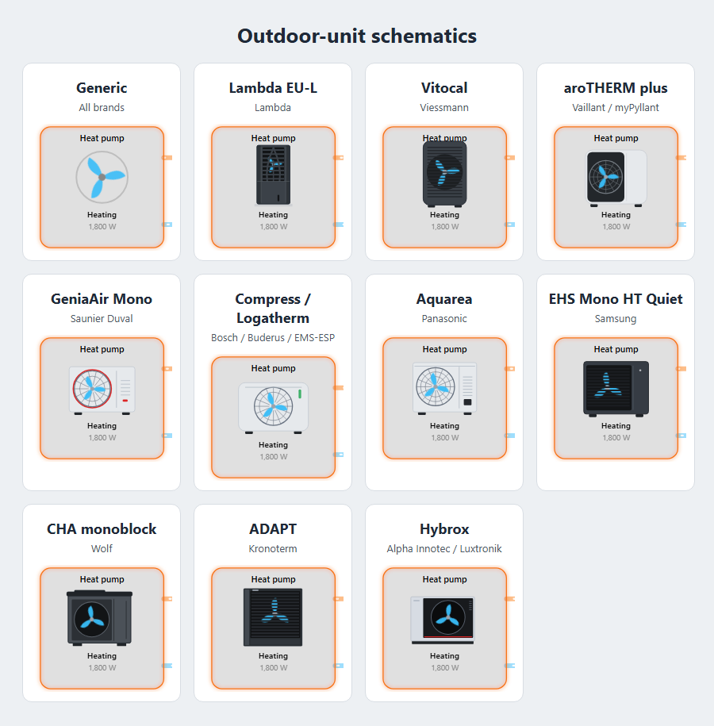

# Configuration reference

Everything on this page can also be set in the card editor, except where it says YAML only. The [README](../README.md) has the overview, installation and troubleshooting; each preset has its own page in [presets](presets). Answers to common setup questions are in the [FAQ](FAQ.md).

## Options

| Option | Description |
|---|---|
| `preset` | `lambda`, `vicare`, `vaillant`, `emsesp`, `bosch_buderus_heating`, `heishamon`, `wolf`, `kronoterm`, `ebusd`, `open3e`, `luxtronik`, `nibe`, `stiebel_isg`, `thz`, `samsung`, `ehs_sentinel`, `espaltherma`, `airahome` or omit. Fills entities, mode maps and error sensors. |
| `prefix` | Preset prefix (Lambda device name, Vaillant home slug, EMS-ESP instance prefix, HeishaMon MQTT prefix, Wolf device slug (`wolflink` only), ebusd topic prefix). Omit for auto-detection, `""` for unprefixed Lambda ids. |
| `device` | Device id: restricts preset detection to one device (several heat pumps of the same brand). |
| `index` | Unit numbers for presets: `{hp, dhw, buffer, hc}` (default 1; Vaillant counts from 0). |
| `hc_type` | Circuit 1: `underfloor` (default), `radiator` (panel radiator) or `column` (column radiator). |
| `hc_count` | Number of heating circuits, 1 (default) to 6. Presets fill the further circuits with the next circuit numbers. The schematic grows by one row per circuit. |
| `hc2_type` to `hc6_type` | Emitter of circuits 2 to 6 (default `underfloor`). |
| `hc_name`, `hc2_name` to `hc6_name` | Circuit titles (default "Heating circuit 1", "Heating circuit 2", …). |
| `hc_flow_label` | Show the flow temperature at each heating circuit (default `true`). A circuit without its own `hc_flow` sensor and without a buffer shows the heat pump's flow, which rises during a hot-water charge; `false` hides the value and keeps the circuit target. A dew-point warning still shows its flow value. |
| `hc_return_label` | Show the return temperature of each heating circuit under its return pipe, from `hc_return`, `hc2_return` … (default `false`). Only the circuit's own return sensor is shown; narrow cards hide the label. The prefix `RL` is the text `return_short`. |
| `narrow_values` | Secondary values below 500 px. Unset (default): each stands where there is room for it (see "Narrow cards" below). `true`: configured buffer and hot-water tank middle/bottom values, the hot-water target line, circuit-return labels and the flow rates (heat pump, circuits, source) always stand, the others where there is room. `false`: all of them are left out. |
| `narrow_focus` | Phone focus below about 500 px (default `false`): the key values grow to about the size of the tank temperature (heat output and COP in the heat pump block, flow and return, the room target and the rooms of up to three circuits); the flow rates of the heat pump and the circuits grow as well where there is room for them, else they are left out. Outdoor and air inlet temperatures, PV, battery and grid power and the room humidity of a single circuit move to one text line under the schematic. The input power, the status line of the heat pump block, the circuit flow/target label (a dew-point warning stays), circuit and valve state texts and the power source labels are hidden. Wider schematics look the same with and without it. With `narrow_values` also set, its tank sub-values and circuit return stay. |
| `spread_unit` | Unit of the spreads: `K` (default) or `°C`. It applies to the spread tiles (heat pump, circuits, source), the ΔT of the source in the schematic and the temperature differences in the run details. The SI allows both for a difference; K says that it is one, °C reads more familiar on a household dashboard. Superheat, subcooling, the heating curve shift and the dew-point margin stay in K. |
| `flow_rate_unit` | Unit in which flow rates are shown: `l/h` (default), `l/min` or `m³/h` (also written `m3/h`). It applies to the heat pump and source loops in the schematic, the circuits, the flow-rate tile and the run details. The sensors may report any of these units; calculations stay in l/h. |
| `buffer_values` | `default`: large top buffer temperature with smaller middle/bottom values. `equal`: all configured buffer temperatures use the same size and are distributed evenly over the tank. |
| `source_type` | `air` (default), `brine` (ground loop), `water` (groundwater wells) or `exhaust` (exhaust air of the ventilation: `source_in` is the exhaust air from the rooms, `source_out` the vented air). The `nibe` preset reads `exhaust` from an F370 or F470. |
| `primary_pump` | Draw the heat pump's own primary pump on the flow pipe next to the heat pump block, instead of a pump in the heating circuit. It turns while `primary_pump_state` is on, if mapped; else while the flow rate is above 0, else with the heating or hot-water loop, and slowly while the heat pump only circulates water. A single direct circuit without a `hc_pump` sensor then shows no pump of its own. The default comes from the preset: on for HeishaMon, Samsung and Kronoterm, off otherwise. ViCare draws its circuit pump here in a single circuit without a buffer, because it is the indoor unit's pump in front of the valve; `false` keeps it in the circuit. Also in the editor. |
| `storage` | `separate` (default): a hot-water tank and, with its sensors, a buffer. `combined`: one combined (layered) storage, drawn as a tall tank with the hot-water zone on top and the heating zone below, also without sensors (also in the editor). The storage keys keep their meaning as heights from top to bottom: `dhw_top`, `dhw_middle`, `dhw_bottom` in the hot-water zone, `buffer_top`, `buffer_middle`, `buffer_bottom` in the heating zone; the tank colour runs over every sensor at its height (a sensor without a value takes the colour of the nearest one). The diverter valve charges the top zone for hot water and the middle for heating, cooling runs through the heating zone as well; the heating circuits draw from the heating zone like from a buffer. `dhw_heater` and `buffer_heater` sit in their zone, solar thermal enters the hot-water zone. `combined` is not used together with `buffer` or `series_buffer`. Presets never set it, because they cannot tell one tank from two. |
| `condenser` | Where the condenser sits (also in the editor with a combined storage): `water` (default, in the heat pump, which heats water that flows to the storage) or `tank` (a coil in the combined storage itself, as in the exhaust air units NIBE F370 and F470). `tank` implies `storage: combined`; refrigerant lines run to the tank, and the water loop, the diverter valve, the primary pump and the labels of `flow`, `return` and `volume` are not drawn. With a boiler the water loop stays, because the boiler stands on it. |
| `dhw_type` | How the tap water is heated (also in the editor): `coil` (default, a heat-exchanger coil in the tank), `fresh_water` (a fresh-water station: with `storage: combined` drawn beside the hot-water zone; with separate storages and a parallel buffer it replaces the hot-water tank and stands on the buffer, without a diverter valve, and hot-water operation heats the buffer; `dhw_top` is then the outlet temperature, solar thermal is not drawn because it needs a hot-water tank, and without a buffer the tank with its coil stays) or `tank_in_tank` (an inner tank in the hot-water zone, only with `storage: combined`). The tap side is not drawn and the station pipes do not animate. With a fresh-water station on the buffer the `dhw_loss` tile is not offered; with a combined storage it needs the pump of every heating circuit (`hc_pump`, `hc2_pump` …) and leaves out every window in which one of them runs. |
| `buffer` | `true` draws a parallel heating buffer even without `buffer_top` or `buffer_mode` (default `false`, also in the editor). Without temperature sensors the tank and its circuit side stay neutral and show no inferred value; `hc_flow` / `hc_return` still colour their own circuit when mapped. Buffer entities continue to draw the buffer automatically. Not together with `storage: combined` or `series_buffer`. |
| `series_buffer` | `true` draws a series buffer in the return of the heating circuits with a 3-way bypass valve (default `false`, also in the editor). Normally the circuit return runs through the buffer. While `bypass_valve` is on, or without that entity while the heat pump defrosts, the flow runs straight into the buffer and the circuits stand still, so the heat pump defrosts from the buffer water. The buffer needs no sensors; a parallel buffer selected with `buffer: true` or implied by its own entities wins for existing configurations. Hand-written YAML must not set both options. |
| `series_bypass` | `false` for a series buffer without a bypass valve (default `true`, in the editor only with `series_buffer`): the card draws no valve, the circuit return always runs through the buffer and the circuits keep running in defrost. |
| `title` | Card title (default: "Heat pump" / "Wärmepumpe"). |
| `language` | `auto` (default, follows the Home Assistant language), `en`, `de`, another built-in language ([docs/TRANSLATING.md](TRANSLATING.md)) or a lowercase language code defined in `texts`. |
| `texts` | YAML-only nested language map for custom labels/translations. Missing labels fall back to English; see [Custom texts and languages](#custom-texts-and-languages). |
| `theme` | `auto` (default, follows Home Assistant), `night` or `contrast`. |
| `fullscreen` | Show the full-screen button (default `true`). Set to `false` to hide it. |
| `power_threshold` | Counts as running above this electrical power in W (default 100; a preset can set its own, EHS Sentinel 300 W for its standby draw). |
| `power_sources` | `auto` (default): PV / battery / grid from the Energy dashboard unless `pv`, `battery` or `grid` are set. `manual`: only your own sensors. |
| `entities` | Entity overrides (see below). `null` removes a preset entity. A list of entities for `power`, `heat`, `pv`, `battery` or `grid` shows the sum of their values, a list for `room` or `room_humidity` (and `hc2_room` …) their mean. A list for `defrost` (one entity per unit of a cascade) means defrost while any one of them defrosts; the defrosts of all of them add up. |
| `units` | Units of a cascade, each with its own `power` and `heat` entity (or a list that is added up), an optional `name`, an optional `heat_max_age` in minutes (#173) and an optional `power_threshold` in W above which the unit runs (default 50). The card pairs heat and power per unit: the drawer shows power, heat and COP of each unit, the status line how many run. The COP of the system needs the heat of every running unit, written within the last 10 minutes or its `heat_max_age`; a standing unit adds no heat. See [Cascades](#cascades). |
| `mode_map`, `dhw_mode_map`, `buffer_mode_map`, `hc_mode_map` | Raw state → normalized mode, merged over the preset. |
| `valve_map` | Raw state of the `valve` entity → `dhw` or `heating`, for a valve that does not follow "on = hot water", for example a zone valve with `1` for heating and `0` for hot water: `valve_map: { 0: dhw, 1: heating }`. States that are not in the map keep the default reading (`on`, `Tank`, `DHW` … mean hot water). The map also applies to the timeline when it is drawn from the compressor and the valve. The values are accepted in any case and as `heat`, `hot water` or `hot_water` too. In the visual editor the map is two fields under "Advanced", shown when a valve entity is mapped: "Valve states for hot water" and "Valve states for heating", each a comma-separated list of raw states; the helper text shows the current state of the valve. A map written in YAML stays as it is when the card is saved in the editor unless the fields are changed. When the valve is a sensor that reports a number and there is no map, the editor warns that 1 is read as hot water. |
| `running_states` | Raw `status` values that count as compressor running. |
| `errors` | List of error-code sensors. A number ≠ 0 or state `on` shows the error chip. `unknown`, `unavailable`, `off`, `0` and empty do not. Other text is ignored unless `error_ok` is set. |
| `error_ok` | Text states that mean "no error", for example `["No Error", "OK"]` (case-insensitive). With this list, any other known non-numeric text from an error entity shows the chip. Numeric codes count too, written as strings (`error_ok: ["183"]`, NIBE's "defrosting in progress"). Presets may provide this list. |
| `badges` | `[{entity, label}]` chips shown while the entity is on; each can carry `tap_action`, `hold_action` and `double_tap_action`. |
| `program_map` | Raw state of the program entity → `eco`, `night`, `party`, `holiday` or `none`, merged over the preset. Without an entry the card recognises common words (eco, reduced, setback, absenk…, party, holiday, urlaub …). |
| `sg_ready_map` | Raw state of `sg_ready` → `normal`, `blocked`, `boost` or `forced`, merged over the preset. Standard SG-Ready numbers work without a map: 1 = blocked, 2 = normal, 3 = raised targets, 4 = forced operation. Text or binary entities need an explicit map unless they already report one of the four normalized names or the states of the OpenEMS / FEMS heat pump controller. |
| `heater_map` | Number of the `heater` entity → heater stage `0` (off), `1`, `2` or `3`, for a stage field that also counts other heat sources; a number that is not in the map is off. Merged over the preset's map (`thz`), which applies only to the heater entity the preset found, not to one of your own. Example: `heater_map: {3: 1, 4: 2, 5: 3}`. |
| `compressor_speed_max` | Hz or rpm that count as full speed when `compressor_speed` is not a percentage (default: 100 Hz, 6000 rpm). Sets the pace of the animation. |
| `animations` | `auto` (default, respects reduced motion), `always` or `off`. |
| `flow_speed` | Multiplier for all animation speeds, from `0.2` to `3` (default `1`). |
| `source_spread` | Show `source_in − source_out` on a running ground/groundwater loop (default `true`). |
| `brine_pressure_min`, `brine_pressure_crit`, `brine_pressure_max` | Optional brine-pressure thresholds in bar. Below `crit` is critical; below `min` or above `max` is a warning. |
| `hc_pressure_min`, `hc_pressure_crit`, `hc_pressure_max` | Optional heating-pressure thresholds in bar, with the same warning/critical logic, for `system_pressure` and `hc_pressure`. |
| `dew_point_margin` | Minimum safe difference between circuit flow and dew point while cooling, in K (default `2`, range 0–10). Below it the cooling label warns about condensation risk. |
| `unit_style` | Drawing of the outdoor unit: `auto` (default, uses the preset style), `generic`, `lambda`, `viessmann`, `vaillant`, `vaillant_pro`, `saunier`, `bosch`, `panasonic`, `samsung`, `wolf`, `kronoterm`, `alpha_innotec` or `stiebel`. Ground and groundwater sources keep their loop symbol. See [Outdoor-unit style coverage](#outdoor-unit-style-coverage). |
| `unit_size` | Vaillant aroTHERM plus class: `small` (3.5 and 5.5 kW, one fan, low), `medium` (7.5 kW, one fan, default) or `large` (10.5 and 12.5 kW, two fans). Panasonic: `medium` (one fan) or `large` (two fans: T-CAP, 12 and 16 kW, H generation from 9 kW); left out, the HeishaMon preset takes it from the model the heat pump reports (`…_main_heat_pump_model`). |
| `timeline` | `true` shows a strip with the operating mode of the last hours under the schematic (needs the `mode` entity, or the `compressor` and optionally the `valve`, and the Home Assistant history). A mapped `sg_ready` state splits the strip into utility-lock, raised-target and forced-operation periods. |
| `timeline_hours` | Length of the timeline in hours, 3 to 72 (default 24). |
| `timeline_details` | Run details under the timeline (default `true`). A tap on an operating period, Enter or the arrow keys select the run it belongs to: from compressor on to off, divided where heating, hot water and cooling change, so a hot-water charge inside a long run can be selected on its own. Defrost stays a phase of the period it interrupts. A panel shows its time, duration, the phases, whether it was cut by the timeline or still runs, and its place in a series of short runs ("run 3 since 21:00", pause before it). Below follow the values of the run, from the recorder history of its window: for hot water the tank at start and end, whether the target was reached, the heater rod and the defrosts; for heating the mean flow against the circuit target, the mean spread of the heat pump and of circuit 1, the mean compressor modulation, flow rate and outdoor temperature, and the defrosts. For both follow the electricity and heat of the run and its COP, integrated from `power` and `heat` (with `units`, per unit; without a heat entity from flow rate × spread, marked ≈), each only when its history holds a valid value for at least 95 % of the run, and the COP only when both do. Heat drawn during a defrost counts as negative, so a run's heat and COP can be lower than the unit's own heat counter shows. A value without data is left out. Without a compressor entity or its speed, an operating period is shown instead. The `wall` layout keeps one line. `false` keeps the one-line period detail of before. |
| `run_signal` | Where runs and the running state come from (#365). `auto` (default): the compressor, else the operating mode. `units`: while at least one of the `units` is above 50 W or its own `power_threshold`. `power`: while `power` is above `power_threshold`. With `units` or `power`, a running stretch is hot water while the `valve` is on hot water, else heating; the operating mode only decides cooling and a utility lock (and the kind where no valve exists), and defrost comes from a `defrost` entity only. A dip shorter than 2 minutes does not end a run, a stretch shorter than 1 minute is no run. The timeline bar, the runs and the heat pump block follow the same signal, so a status or compressor entity that updates only hourly (ebusd) cannot hold a stale state. Without recorded power history the timeline uses the compressor and the mode. The diagnostic report names the source ("Runs from"). YAML only. |
| `timeline_marks` | `true` adds a lane under the timeline for every badge, showing when it was on (for example Boost). A list of entities or `{ entity, label, color }` entries does the same for other switches, inputs and sensors with an on/off state; `color` (any CSS colour, for example `"#ef4444"`) replaces the badge colour of that lane. Needs the Home Assistant history. |
| `layout` | `default`, `compact` (tighter spacing for narrow columns), `wide` (controls, tiles and details beside the schematic when the card is at least 760 px wide) or `wall` (wide, with large type; the quick controls and the details toggle fade out until the card is touched). |
| `wall_timeout` | Seconds the controls of the `wall` layout stay visible after the last touch or mouse move (default 10, `0` = always visible). |
| `actions` | Tap, hold and double-tap actions per element, keyed by entity key: `{dhw_top: {tap_action: {…}}}`. See [Layout, actions and colours](#layout-actions-and-colours). |
| `controls` | Quick controls: list of entity ids or `{entity, name}`. Supported: `switch`, `input_boolean`, `light`, `fan`, `automation` (toggle), `button`, `input_button`, `script`, `scene` (press), `select`, `input_select`, `water_heater`, `climate` (dropdown), `number`, `input_number` (input). |
| `details` | Extra rows in the details drawer: list of entity ids or `{entity, name, unit, decimals}`. Without a `name`, an entity is named without the device name in front. |
| `details_open` | Open the details drawer by default (default `false`). |
| `tiles` | Your own tile selection, in this order: catalog keys with an optional period (`cop_heating`, `cop_heating:month`, `{key, period, name, decimals, unit}`), card values (`value:hc2_flow`, `{value, name}`) and free entities (`{entity, name, unit, decimals}`). Every tile can carry `tap_action`, `hold_action` and `double_tap_action`. Without `tiles` the default tiles are shown, or the default tiles of the preset (Bosch/Buderus Home Comfort); `tiles: []` hides the row. See [Stat tiles](#stat-tiles). |
| `tile_sources` | Your own counters for catalog tiles, replacing the preset's for that tile: `{energy_heating: sensor.x}` (a total counter; its periods come from long-term statistics) or `{energy_dhw: {today: sensor.a, total: sensor.b}}`. See [Stat tiles](#stat-tiles). |
| `price` | Electricity price per kWh for the `cost` tile: a number or an entity (e.g. a dynamic tariff; ct/kWh and per-MWh prices are converted). `currency` overrides the currency from the HA settings. |
| `stats` | Extra tiles `[{entity, name, unit, decimals}]`, added after the default tiles or after `tiles`; also with `tap_action`, `hold_action`, `double_tap_action`. |

## Entity keys

- **Heat pump:** `mode`, `status`, `compressor` (binary, a frequency/speed > 0, or a running text such as `RUNNING` or `STARTING`), `fan_speed` (rpm, or binary: the fan of the unit drawing turns while it is above 0 or on, and faster at a higher speed; without it the fan follows the running state), `defrost` (binary, or a mode text such as `defrost` or what `mode_map` maps to defrost; a list with one entity per unit of a cascade), `power` (W or kW), `heat` (kW or W), `flow`, `return`, `volume`, `primary_pump_state` (binary: the primary pump's own state; without it the flow rate decides), `system_pressure` (pressure of the heating system in bar, kPa, Pa, hPa, MPa or psi, shown with a gauge at the return of the heat pump; presets map it), `source_volume`, `source_in`, `source_out`, `brine_pressure` (bar, kPa, Pa, hPa, MPa or psi), `outdoor`, `valve` (binary, or a state like `Tank`/`DHW`), `heater` (backup / inline heater), `pv_boost` (PV surplus mode: binary, or a power above 0, see below), `sg_ready` (SG-Ready state or utility lock, see below)
- **Boiler / second heat generator:** `boiler_state` (binary, a numeric level/power, or a common running state such as `running`, `heating` or `burner`), optional `boiler_power` (W or kW) and optional `boiler_flow` (°C). Setting any of these keys draws a separate boiler in series in the common flow before the existing diverter valve. The card distinguishes heat-pump-only, boiler-only and simultaneous operation; the valve still decides whether the common flow goes to heating or hot water. If `boiler_state` is omitted, `boiler_power > 0` is the running signal. This is separate from `heater`, the heat pump's backup/inline heater. Presets do not map boiler entities automatically.
- **Storage:** `dhw_top`, `dhw_middle`, `dhw_bottom`, `dhw_target`, `dhw_mode`, `circulation`, `circulation_start`, `circulation_end`, `circulation_schedule`, `dhw_enabled` (the text `off` = hot water switched off, for presets that read hot water from the flow temperature: ViCare), `dhw_once` (one-time charge, on/off), `dhw_loss_sensor` (optional plain sensor used only to fit the standby-loss slope), `dhw_heater` (or `dhw_heater_top`, `dhw_heater_middle`, `dhw_heater_bottom` for rods at three heights), `buffer_top`, `buffer_middle`, `buffer_bottom`, `buffer_mode`, `buffer_heater` (or `buffer_heater_top`, `buffer_heater_middle`, `buffer_heater_bottom`), `bypass_valve` (series buffer: on = bypass, see `series_buffer`), `solar_collector`, `solar_pump` (needs the DHW tank). Without any hot-water key the card draws no tank: when the operating mode reports hot water, the heat pump shows "Hot water" and runs, but no pipe flows, because the card cannot show where the heat goes.
- A tank sensor colours the storage only from its measured height. If `dhw_top` is missing, the unmeasured upper zone stays neutral instead of copying a cooler middle or bottom sensor; this avoids suggesting that the whole tank is cold when useful hot water may remain above the highest sensor.
- **Heating circuit and house:** `hc_flow`, `hc_return`, `hc_setpoint`, `hc_mode`, `hc_pump`, `hc_volume`, `hc_curve_offset` (shift of the heating curve in K, see HeishaMon; also `hc2_` to `hc6_`), `hc_mixer`, `hc_mixer_opening`, `hc_mixer_closing` (three-way mixer of a mixed circuit, also `hc2_` to `hc6_`: any of them draws the valve on the circuit flow and the bypass from the return; `hc_mixer` is a position or share in % and is shown as reported, `hc_mixer_opening` / `hc_mixer_closing` are the motor outputs and show an arrow while on; `hc_mixer_opening` may instead carry a signed movement, above 0 opening and below 0 closing, as ebusd reports it for a VR 71), `hc_pressure` (bar, kPa, Pa, hPa, MPa or psi: a pressure drawn at circuit 1, for example behind a heat exchanger; setting it, also to `null`, replaces the `system_pressure` of a preset unless you set that too), `room`, `room_target`, `room_humidity`, `dew_point`, `program` (eco, night, party, holiday)
- **Direct systems:** without a buffer and without circuit-specific temperature sensors, circuit 1 uses the heat pump's `flow` and `return` and remains connected in the schematic.
- **Thermostats as temperature sources:** a temperature key also takes a `climate` or `water_heater` entity. The card reads its `current_temperature`, and its target `temperature` for `dhw_target`, `room_target` and the `_setpoint` keys. One DHW thermostat can serve as `dhw_top` and `dhw_target`.
- **Circuits 2 to 6:** the same keys with `hc2_` to `hc6_` (`hc2_flow`, `hc6_pump`, …)
- **Room overview per circuit:** `room` / `room_target` belong to circuit 1; `hc2_room` to `hc6_room` and `hc2_room_target` to `hc6_room_target` add the other circuits, for example one room sensor per floor. With several circuits the house shows one row per circuit with its name, actual and target temperature. A blue, green or red dot marks whether the actual value is below, within or above 0.5 K of the target. Each row opens its room sensor (or the target without one); the status below each emitter remains reserved for its operating mode. With one circuit the familiar large room value in the house remains unchanged. Presets do not fill the additional circuit keys yet.
- **Cooling humidity and dew point:** `room_humidity` adds relative humidity to the room overview. During cooling, the circuit label shows flow and dew point and warns when their difference is below `dew_point_margin` (2 K by default). Map `dew_point` when an integration provides a measured or controller-calculated value; otherwise the card calculates it from `room` and `room_humidity` with the Magnus formula. Circuits 2–6 use `hc2_room_humidity` / `hc2_dew_point` through `hc6_room_humidity` / `hc6_dew_point`. Missing, unknown or implausible values stay hidden and never cause a guessed warning. No preset maps these keys without verified installation data.
- **Heaters** (`heater`, `dhw_heater`, `buffer_heater`): binary or on/off, a power value (on above 0) or a stage number (1-3). With a power entity (W or kW) the drawing shows the power of a running heater: beside the rod in the tank, outside the tank where a sensor value needs that place, and under the backup heater in the heat pump; without room for it, it is left out. These remain heater rods and are not the separate `boiler_*` heat generator.
- **Circulation program:** map `circulation_start` and `circulation_end` to `time`, `input_datetime` or text entities for one daily window such as `06:00–22:00`. Alternatively, `circulation_schedule` accepts a Home Assistant `schedule` helper and shows its `next_event` as “from 06:00” while off or “until 22:00” while on. A complete explicit window takes priority. Missing, unknown or incomplete values stay hidden; multiple weekday windows and integration-specific preset mappings are not inferred.
- **PV surplus mode** (`pv_boost`): any heat pump or energy manager that raises the heating to take up PV surplus (a PV surplus switch, an SG Ready state turned into on/off, or a power such as the setpoint of the Lambda E-Manager) can feed it. The entity counts as active when it is on or reports a value above 0. The card then shows a "PV surplus" chip next to the mode, turns the heating periods of the timeline in which it was active into "Heating · PV surplus" (hatched), and offers the tile `pv_boost_share` (share of the heating time in PV surplus mode today, yesterday and this week, from the recorder history). The Lambda preset maps the E-Manager setpoint (`emgr_power_consumption_setpoint`) automatically; it needs the E-Manager in the integration. Example for another system: `entities: { pv_boost: binary_sensor.heat_pump_pv_mode }`.
- **SG-Ready and utility lock** (`sg_ready`): standard states 1–4 show utility lock, normal operation, raised targets and forced operation. Active instructions appear as a header chip and as distinct periods in the operating timeline. Other numeric, text or binary states are mapped explicitly with `sg_ready_map`; unknown and unavailable states stay hidden instead of being guessed. This first contract is read-only and no preset maps it without verified installation data. The states of the OpenEMS / FEMS heat pump controller (integration `ha_openems`, status and manual state) are understood without a map. Example: `entities: { sg_ready: sensor.heat_pump_sg_ready }`, `sg_ready_map: { EVU lock: blocked, Normal: normal, Recommend: boost, Forced: forced }`.
- **Power sources:** `pv`, `battery`, `grid` – the heat pump's power from each source. Power sensors in W, kW and MW are converted to W. Energy counters in Wh, kWh or MWh cannot show a current flow and are rejected by the editor check. Optional: without own source sensors the card uses the Energy dashboard.
- **Sums:** `power`, `heat`, `pv`, `battery` and `grid` also accept a list of entities. The card adds the values of the members that report a number (W, kW and MW can be mixed); the first member that exists opens on tap and stands for the key in the editor warnings. Example: two meters for compressor and heater rod, `power: [sensor.heat_pump_meter_power, sensor.heater_meter_power]`. A sum with a member that reports no number is still shown, but no COP is formed from it: power and heat would no longer belong to the same machines, for example with one unit of a cascade offline.
- <a id="cascades"></a>**Cascades:** with two or more outdoor units, `units` pairs power and heat per unit, so a heat value of one unit is never divided by the power of both. Example for two units behind one hydraulic station:

  ```yaml
  entities:
    power: [sensor.unit1_power, sensor.unit2_power, sensor.station_power]
  units:
    - name: Unit 1
      power: sensor.unit1_power
      heat: [sensor.ebusd_hmu_currentyieldpower, sensor.ebusd_hmu_currentconsumedpower]
    - name: Unit 2
      power: sensor.unit2_power
      heat: [sensor.heating_ebusd_wp2_hmu_currentyieldpower, sensor.heating_ebusd_wp2_hmu_currentconsumedpower]
  ```

  A unit runs above 50 W. A unit that draws more than that with the compressor off, for example about 60 W for a few minutes after a hot-water charge, gets a higher `power_threshold` (in W), so that standby is neither a run nor a running unit. While it runs, its heat value counts only when it was written within the last 10 minutes; an hourly value (as from a gateway query) is shown as "heat not current" and the system COP is left out, while the other unit keeps its own COP in the drawer. Home Assistant does not write an MQTT sensor again when the same value arrives, so a steady heat value looks old although it is read. Set `heat_max_age` to about twice the read interval of the unit, or to `0` for no age check; the card then no longer notices a reading that stopped. The system COP is the sum of the units' heat divided by `power` (here including the station), or by the units' power without a `power` key. With `units`, the heat of the system and of a run is the sum of the units; a `heat` key, also one a preset maps, is not used for it, since a preset reads the heat of the first unit only. On the aroTHERM, `currentyieldpower` is only the yield from the environment, so the heat of a unit is that plus its `currentconsumedpower`, as in the example (#338). The diagnostic report lists every pair with the age of its heat value.
- **Means:** `room`, `room_humidity` and the room keys of circuits 2 to 6 (`hc2_room`, `hc2_room_humidity` …) also accept a list. The card shows the mean of the members that report a number; a member in °F or K is converted to the unit of the first one, a climate entity counts with its current temperature in the unit of the Home Assistant installation. The value is unknown only when no member reports one. Example: `room: [sensor.living_room_temperature, sensor.kitchen_temperature]`. Other keys take the first entity of a list.
- **Statistics:** `cop_heating_today`, `cop_dhw_today`, `energy_today`, `pv_share_today`, `starts_today`
- **Details, operation:** `hours`, `starts_total`, `aux_hours`, `aux_starts` (heater starts, total counter), `energy_total`, `env_energy` (heat taken from air, ground or water), `heat_total`
- **Details, refrigerant circuit:** `compressor_speed`, `evap_temp`, `cond_temp`, `suction_temp`, `hot_gas`, `liquid_temp`, `low_pressure`, `high_pressure`, `eev`, `superheat`, `subcooling`
- **Details, cut-out counters:** `cutout_high_pressure`, `cutout_low_pressure`, `cutout_temperature`. These are cumulative **counts of cut-out events** from your integration, not pressures or temperatures. They appear in their own drawer section "Cut-outs (number of events)" as whole numbers with a times sign (for example "3 ×"), separate from the refrigerant circuit values above. No preset fills them yet; map them yourself until entity meaning and units are verified for an integration.

A house with one circuit per floor, each with a room sensor of its own:
```yaml
hc_count: 2
hc_name: Ground floor
hc2_name: Attic
entities:
  room: sensor.living_room_temperature   # circuit 1, shown in the house
  hc2_room: sensor.attic_temperature     # circuit 2, shown under its emitter
  hc2_room_target: sensor.attic_target   # optional
```

## Stat tiles
In the UI editor, switch on **Own tile selection**. The editor then offers only the tiles your installation can fill: the statistics, each once, then the values of the drawing and the details, listed by component and heating circuit, and the further values of the details (`details` of the preset or your own). A statistic comes with its usual period; **Tile** and **Period** below the list change the period of a chosen statistic, also of one added before, where **7 days · with trend** and **30 days · with trend** add the arrow (see "Rolling windows and trends"). Adding the same statistic again gives a further tile with a period not chosen yet. **Add a Home Assistant entity as a tile** appends any entity; entity and value tiles can be named in the fields below the list. Drag the tiles to sort. Enter an electricity price (a number or an entity) to get the cost tile. In YAML:

```yaml
price: sensor.epex_spot_price   # or a number, e.g. 0.30
tiles:
  - cop_heating               # without a period: today if possible, else the current value or the total
  - cop_heating:month
  - key: energy
    period: today
  - env_energy:month          # environmental energy from a total counter's long-term statistics
  - starts
  - defrosts:yesterday
  - cop_heating:last_month    # the calendar month before
  - last_heating_run          # duration, electricity, heat and COP of the last complete heating run
  - cop_total:7d              # last 7 complete days, with the trend against the 7 days before
  - cop_weather               # the same COP against the usual at this outdoor temperature
  - cost:month                # electricity × price, currency from the HA settings
  - key: energy_heating
    period: month
    tap_action:               # any Home Assistant action; default: more-info
      action: navigate
      navigation_path: /energy
    hold_action:
      action: more-info
  - value:buffer_bottom       # a value of the drawing or the details, by its entity key
  - value: hc2_flow
    name: Upstairs flow
  - entity: sensor.my_value   # any entity as a tile
    name: My value
```

**Card values:** `value:<entity key>` shows what the drawing or the details show for that key (see "Entity keys"), with the same source, unit and calculation: the split of the Energy dashboard for `pv`, `battery` and `grid`, the calculated `dew_point`, `superheat` and `subcooling`, the state names of modes. `value:unit1`, `value:unit2` … show the units of a cascade (`units`) as in the details. On/off keys show on or off; a heater rod whose entity reports W or kW shows its power. A value of a heating circuit carries the circuit's name or number. An unavailable value shows "–", and a key without an entity has no tile. The editor leaves out values that a catalog tile already shows.

**Cost:** with a fixed price, cost = electricity of the period × price. With a price entity that has long-term statistics (`state_class: measurement`, true for most tariff sensors), the card bills every hour at that hour's mean price, from Home Assistant's long-term statistics. The current hour, which is not yet in the statistics, is billed at the current price. For the year the card uses daily values and for the total monthly values, so these are marked **≈**. A price entity without statistics is applied to the whole period at its current price, also marked **≈**. A tile can have its own `price` and `currency`. If your tariff sensor once changed its unit (for example from ct/kWh to €/kWh), its older statistics keep the old values and the cost for longer periods comes out too high. In that case, fix the statistics under Developer tools > Statistics.

**Own counters:** when your installation reports counters the preset does not use (for example electricity and heat split into heating and hot water from an Optolink splitter or a heat meter), give them to the catalog tiles with `tile_sources`. A single entity is a total counter: with `state_class: total_increasing` the card derives today, week, month and year from its long-term statistics, and the COP tiles are computed from heat and electricity. A map names the entity of each period. Own sources replace the preset's for that tile; `none` removes them.

```yaml
tile_sources:
  energy_heating: sensor.vitocal_electricity_heating_total
  energy_dhw: sensor.vitocal_electricity_dhw_total
  heat_heating: sensor.vitocal_heat_heating_total
  heat_dhw:
    today: sensor.vitocal_heat_dhw_today
    total: sensor.vitocal_heat_dhw_total
tiles:
  - cop_heating:month
  - energy_heating:month
  - heat_dhw:today
```

Tile keys that take a source: the electricity, environmental energy and heat keys, `cop_heating`, `cop_dhw`, `cop_cooling`, `cop_total`, `spf`, the starts and runtime keys, `pv_production` and `solar_thermal`. Live values (`cop_live`, `spread`, `power` …), `cost`, `load_classes`, `dhw_loss`, `pv_boost_share` and `last_heating_run` are computed and take none.

**Rolling windows and trends:** the periods `7d` and `30d` are the last 7 and 30 complete days, from the daily long-term statistics of the counters (without today). They work for electricity, heat, COP, starts and runtime. The tile adds a trend against as many days before: ▲ or ▼ with the change, ▶ below 3 %. Green and red only judge a COP; more electricity or heat is neither good nor bad. A COP is the heat of the days divided by their electricity, over the days both counters have; a day that was reset or corrected is left out, and with less than 85 % of the days there is no value. `trend: false` leaves the arrow out (`{key: cop_total, period: 7d, trend: false}`).

**Weather-adjusted COP:** a COP falls when it gets colder, so a plain trend mostly shows the weather. `cop_weather` (all heat) and `cop_heating_weather` (heating) compare the COP of the last 7 days with what was usual at the same outdoor temperatures: `≈4.71 ▶ +1.5 %`. The card learns the usual from the 28 days before (a straight line through the daily COPs over the mean outdoor temperature, weighted by electricity). Deviations below 3 %, or below twice the scatter of the learned days, show ▶. A `?` marks days colder or warmer than anything learned. Needs total counters for heat and electricity and an `outdoor` sensor with `state_class: measurement`, at least 14 usable days over 4 K; without them the tile shows "–". It is a simple model: other influences (flow temperature, hot-water share, sun) are not in it.

**Actions:** a tap opens the more-info dialog of the tile's entity. `tap_action`, `hold_action` (500 ms) and `double_tap_action` accept every Home Assistant action (`more-info`, `navigate`, `url`, `toggle`, `perform-action`, `assist`, `none`, with `confirmation`). Tiles with options the editor does not offer (such as price, unit, period with an own entity or actions) are marked **YAML** there: they can be moved and removed, their options are edited in YAML and stay as they are when the editor saves.

**Last month:** `last_month` is the calendar month before the current one, in the time zone of Home Assistant. It needs a total counter (`state_class: total` or `total_increasing`), or for starts and hours a counter kept as a measurement, with long-term statistics over that month; a COP needs the heat and the electricity counter, and counters that started within the month give values from there on. With a dynamic price the cost bills every hour at its price; hours without a price count at the mean of the others, marked **≈**.

**Last heating run:** `last_heating_run` shows the last complete heating run in the window of `timeline_hours`, with the same bounds as the run panel of the timeline: `2 h 05 min · 1.40 → 5.80 kWh · COP 4.1` (electricity → heat). A run that still goes, that the window cuts or that begins or ends where data are missing does not count, nor does hot water. Values without recorded data are left out, an estimated heat is marked **≈**. The label carries the time of the run. With `timeline: true` a tap selects the run there; without a timeline the tile loads the history itself and a tap opens the entity that delimits the runs.

Periods: `now`, `today`, `yesterday`, `week`, `month`, `last_month`, `year`, `total`, `7d`, `30d`. A tile is only shown when the installation can fill it. Values come from, in this order:
1. the preset's own entity for that period (e.g. Lambda `hp1_heating_cop_monthly`)
2. for the default tiles' entities (`cop_heating_today` …): "today"
3. the change over the period from Home Assistant's **long-term statistics** of a total counter (needs `state_class: total_increasing`, true for most energy counters). This gives EMS-ESP and others "today", "this month", "last month" and so on, although they only report totals. Start and hour counters with `state_class: measurement` give their periods from the highest and lowest value of the period.
4. counted from the **history** for today, yesterday and the week: `defrosts` from the defrost entity switching on, where no defrost counter exists. For HeishaMon the starts of these periods leave out the two restarts of every defrost, which its operations counter also counts.
5. computed from other tiles, marked **≈**: COP = heat ÷ electricity, or without heat = (environmental energy + electricity) ÷ electricity; runtime per start = hours ÷ starts.

| Group | Tile keys |
|---|---|
| Efficiency | `cop_live`, `cop_heating`, `cop_dhw`, `cop_cooling`, `cop_total`, `spf` (year), `cop_weather`, `cop_heating_weather` (7d) |
| Electricity | `energy`, `energy_heating`, `energy_dhw`, `energy_cooling`, `energy_defrost`, `energy_standby`, `energy_aux` (heater) |
| Environmental energy | `env_energy` |
| Heat | `heat`, `heat_heating`, `heat_dhw`, `heat_cooling`, `heat_defrost` |
| Starts and runtime | `starts`, `cycles_heating`, `cycles_dhw`, `cycles_cooling`, `defrosts`, `hours`, `hours_heating`, `hours_dhw`, `hours_defrost`, `hours_per_start`, `load_classes`, `aux_hours`, `aux_starts` |
| Live | `spread`, `volume`, `heat_estimated`, `power`, `heat_live`, `compressor_speed`, `source_spread`, `outdoor`, `dhw_top`, `room`, `brine_pressure`, `hc_pressure`, `hc_spread` … `hc6_spread`, `pv_share` |
| Other | `pv_production`, `solar_thermal` (ViCare), `cost`, `dhw_loss` (hot-water standby loss, K/h), `last_heating_run` |
| PV surplus | `pv_boost_share` (needs `pv_boost`; periods `today`, `yesterday`, `week`) |

`hc_spread` is the spread of heating circuit 1 from its own `hc_flow` and `hc_return`, `hc2_spread` … `hc6_spread` that of the other circuits. Next to `spread` (flow minus return of the heat pump) it shows what the circuit takes behind a buffer or mixer. A circuit spread is offered when both sensors of that circuit are mapped, shows "–" while no water moves through the circuit, and carries the circuit name (`hc2_name` …) or its number.

What the presets provide:
- **Lambda:** COP heating/DHW/cooling per day, month, year and in total; electricity and heat per mode including defrost and standby; starts, heating/DHW/cooling cycles and defrosts per day and yesterday; running time for heating, DHW, defrost and the heater rod, where the integration provides them (seen in V3.7).
- **ViCare:** COP and SPF, electricity per day, week, month and year (total, heating, DHW, cooling), compressor hours, starts and load classes, heater rod hours and starts, PV and solar thermal yield.
- **EMS-ESP:** totals for electricity, heat, starts and hours per mode; other periods from long-term statistics.
- **HeishaMon:** heat and electricity per mode as current power, so the COP tiles work for "now"; operating hours and starts.
- **Samsung:** electricity, heat and COP today (template sensors of `example.yaml`) and in total; other periods from long-term statistics.
- **Vaillant:** daily electricity and heat for heating and DHW.
- **Kronoterm:** electricity today in total and per heating, DHW and heater (Cloud API); week, month and year from the electricity counter; COP total from the SCOP; heating, DHW and cooling compressor starts as totals.

## Layout, actions and colours
**Layout.** `layout: compact` reduces padding and type sizes for narrow dashboard columns. `layout: wide` shows the schematic on the left and controls, tiles and the details drawer on the right once the card is at least 760 px wide (below that it falls back to the normal stacked layout), which suits wall tablets. `layout: wall` is the wide layout with about 30 % larger type for reading from a distance. The quick controls and the details toggle are invisible and not clickable until a touch or mouse move wakes the card; after `wall_timeout` seconds (default 10) they fade out again and an open details drawer closes. A control in use, such as an open dropdown, keeps the card awake. All layouts are also in the editor.

**Animations.** `animations: auto` (default) respects the operating system's reduced-motion preference. Use `animations: always` to animate anyway or `animations: off` for a static schematic. `flow_speed` scales all movement from `0.2` to `3` (`1` is the default); sensor-driven fan, pump and flow differences are preserved. Both options are in the editor.

**Full screen.** The expand button opens the existing card instance in an overlay, so it does not duplicate entity subscriptions, history requests or control state. Close it with Escape, the close button or a click outside the card; keyboard focus stays inside the overlay and returns to the expand button afterwards. Set `fullscreen: false` to remove the button. The overlay follows viewport changes and safe areas on phones and tablets.

**Card theme.** `theme: auto` keeps the dashboard's Home Assistant theme and all `--hfc-*` overrides. `theme: night` dims fixed colours for dark rooms. `theme: contrast` uses stronger black/white surfaces, role colours, thicker pipes and more visible focus outlines. These are fixed per-card choices; automatic time- or entity-based switching is deliberately outside this option.

For ground and groundwater sources, the loop shows `ΔT` while the compressor runs when both `source_in` and `source_out` are available. Set `source_spread: false` to hide it; the source-spread tile remains available independently.

**Actions on elements.** Every element of the schematic shows an entity, and a tap opens its more-info dialog. To change that, give the entity key of the element (see "Entity keys") its own actions. They accept every Home Assistant action, the same as the tiles: `more-info`, `navigate`, `url`, `toggle`, `perform-action`, `assist`, `none`, with `confirmation`. A hold takes 500 ms.

```yaml
actions:
  dhw_top:                      # the hot water tank
    tap_action:
      action: navigate
      navigation_path: /lovelace/hot-water
    hold_action:
      action: more-info
  mode:                         # the heat pump block and the mode chip
    double_tap_action:
      action: perform-action
      perform_action: script.heat_pump_boost
badges:
  - entity: input_boolean.boost
    label: Boost
    tap_action:
      action: toggle
```

An action for a key the card has no entity for does nothing; the browser console says so. Actions are edited in YAML.

**Narrow cards.** The type size follows the width of the schematic, not the screen: below about 640 px the labels grow, below about 500 px (phones, narrow columns) they grow further. The VL / RL prefixes are left out there, and secondary labels stand only where there is room beside the important numbers, in this order: flow rate and bottom temperatures of the tanks; power of a heater rod, hot water target line and circuit flow rates; middle temperatures and circuit returns; circulation and source flow; valve. Set `narrow_values: true` to keep the configured buffer and hot-water tank middle/bottom values, the hot-water target line, circuit-return labels and flow rates in any case, or `false` to leave all secondary labels out, as 0.20 did without the option. Chip text takes the colour of your theme text, so it reads in light and dark themes.

**Colours.** The card draws with these CSS variables. Set them in a theme or per card with card-mod; without a value the default applies. The card keeps styles injected by card-mod across its initial setup and later configuration or entity-registry rebuilds.

| Variable | Default | Used for |
|---|---|---|
| `--hfc-heat` | `#f97316` | running heat pump, heating chip, heater rod, impeller, heat waves |
| `--hfc-hot` | `#dc2626` | hot water chip, error chip, second heater stage |
| `--hfc-cool` | `#38bdf8` | fan blades while running, groundwater |
| `--hfc-cool-strong` | `#0ea5e9` | snowflake, circulation pump |
| `--hfc-defrost` | `#7dd3fc` | flow pipe while defrosting or cooling |
| `--hfc-flow-cold`, `--hfc-flow-hot` | `#fb923c`, `#dc2626` | flow pipes, 25 to 55 °C |
| `--hfc-return-cold`, `--hfc-return-hot` | `#7dd3fc`, `#2563eb` | return pipes, 20 to 45 °C |
| `--hfc-tank-cold`, `--hfc-tank-cool`, `--hfc-tank-warm`, `--hfc-tank-hot` | `#3b82f6`, `#22d3ee`, `#f97316`, `#ef4444` | tank gradient in four steps, 20 to 58 °C |
| `--hfc-anthracite` | `#3b4148` | dark casings: Lambda unit, dark panel of the Vaillant unit |
| `--hfc-casing` | `#e6e9ec` | light casing of the Vaillant unit |
| `--hfc-pv`, `--hfc-battery`, `--hfc-grid` | `#f59e0b`, `#10b981`, `#94a3b8` | power sources and their flow lines |
| `--hfc-good` | `#16a34a` | live COP |
| `--hfc-badge` | `#a855f7` | badge chips |
| `--hfc-brine`, `--hfc-ground` | `#60a5fa`, `#a16207` | brine pipes, ground loop |
| `--hfc-flow-dash` | `rgba(255,255,255,.9)` | the moving dashes in the pipes |
| `--hfc-idle-mix` | `35%` on a dark card, `32%` on a light one, `22%` while Home Assistant reports no dark mode | how much of its colour a standing pipe keeps, mixed into the card background. With `theme: auto` the card follows the dark mode Home Assistant reports; `night` uses the dark value, `contrast` the light one |

```yaml
type: custom:heatpump-flow-card
preset: lambda
card_mod:
  style: |
    :host {
      --hfc-heat: #14b8a6;
      --hfc-tank-hot: #f43f5e;
    }
```

## Custom texts and languages

The built-in English and German text can be overridden or extended in YAML. Select the language with `language`; every omitted key falls back to English, so a translation can start small:

```yaml
type: custom:heatpump-flow-card
preset: lambda
language: nl
texts:
  nl:
    title: Warmtepomp
    modes:
      heating: Verwarming
    tiles:
      cop_heating: COP verwarming
```

Language codes must be lowercase (`nl`, `pt-br`). Values are treated as plain text and escaped before they are rendered. The stable key tree and placeholder rules are documented in [`docs/TEXTS.md`](TEXTS.md). The visual editor preserves `texts`, but editing the nested map remains YAML-only; the editor itself is available in the built-in languages only.

The built-in languages and how complete they are: [Languages in the README](../README.md#languages) and [coverage](COVERAGE.md#languages).

Would you like your language built in for everybody, including the editor? Translations are welcome and can be partial: [docs/TRANSLATING.md](TRANSLATING.md).

## Diagnostic report

The document button in the card header copies a plain-text diagnostic report to the clipboard. It includes the card and Home Assistant versions, language, resolved preset and prefix, layout/source choices, the hydraulic options (storage, hot-water preparation, parallel or series buffer, primary pump), what the preset detection looked for, the heat pump integrations in Home Assistant (names and entity counts only) and the presets that match, every entity mapping with its current state, unit and source (`[preset]`, `[own]`, or `[own · <integration>]` when it comes from another integration than the preset's), cleared and unmapped keys in one line each, the PV, battery and grid sources (each Energy-dashboard source with its power sensor and value, or the own sensors), the plausibility checks of the editor, the value maps (`valve_map`, `mode_map`, `dhw_mode_map`, `buffer_mode_map`, `hc_mode_map`, `program_map`, `sg_ready_map`) with their source (preset or configuration; a map placed under `entities` by mistake is named, because the card ignores it there), error sensors and quick controls. It does not include a registry or attribute dump and never sends data anywhere.

Entity ids can still contain room, person or installation names. Read the report and remove anything private before sharing it in an issue. The report is the preferred input for preset testing and bug reports because it shows both detected and missing mappings without requiring screenshots of Developer Tools.

## Keyboard and screen readers
The card works without a mouse or touch screen.
- **Tab** goes through the header chips, then the schematic, the quick controls, the tiles and the details toggle. The schematic, the tiles and the details are one tab stop each: inside them the **arrow keys** move to the next or previous part, **Home** and **End** jump to the first and last. A frame (in the theme's primary colour) marks the focused part.
- **Enter** or **Space** runs the tap action (by default the more-info dialog), **Shift+Enter** runs the hold action and **Alt+Enter** the double-tap action, so `tap_action`, `hold_action` and `double_tap_action` are all reachable from the keyboard.
- Parts of the schematic are buttons with a label made of the entity name and its current value, for example "Flow temperature: 32.4 °C". Parts without a value (empty labels, labels hidden on narrow cards) are skipped.
- The quick controls and the details toggle are ordinary buttons, dropdowns and inputs. With `layout: wall` the controls appear as soon as one of them gets the focus.

| Keyboard focus |
|---|
|  |

## Where the numbers come from
The card shows what your integration provides and does not invent values. Where it has to derive something, this is how:

| Value | Source |
|---|---|
| Temperatures, power, flow rate, daily COP, energy, starts | Read directly from the entities. Power units W, kW and MW, flow units l/h, l/min and m³/h, and energy units Wh, kWh and MWh are converted within their own quantity; energy counters are never treated as current power. Nothing else is changed. |
| Spread | Flow minus return temperature. |
| Heat output | The heat output entity if there is one. Otherwise **estimated** as flow rate × spread × 1.163 Wh/(l·K) (water) and marked with **≈**. With glycol in the circuit the estimate is slightly too high. |
| Live COP | Heat output ÷ electrical power while the compressor runs. Marked with **≈** when the heat output is estimated. |
| Running | Compressor entity on (or frequency/speed > 0), electrical power above `power_threshold` (default 100 W), or a running status from the preset. With `run_signal: units` or `power`, the power alone decides. |
| Mode | The operating-mode entity, translated by the preset's `mode_map`. An active `defrost` entity shows defrost even when the mode entity keeps reporting heating (e.g. Kronoterm). Without a mode entity (e.g. HeishaMon): compressor off = standby, defrost entity on = defrost, valve on DHW = hot water, otherwise heating. |
| Diverter valve | The valve entity (on, `Tank` or `DHW` = hot water; or the states of your `valve_map`), otherwise the mode. |
| Heating circuit active | Circuit pump, else circuit mode, else "heat pump is heating". |
| PV / battery / grid flows | Your own `pv` / `battery` / `grid` sensors if set. Otherwise **estimated** from the Energy dashboard and marked with **≈**: the heat pump's power is split by the house's current supply mix (PV used in the house, battery discharge, grid import); PV first covers battery charging and export. Needs current-power sensors in W, kW or MW and the heat pump's `power`; Wh, kWh and MWh counters cannot provide live flow. A flow is animated above 10 W. |
| Superheat, subcooling | The integration's value if there is one. Otherwise superheat = suction gas − evaporation and subcooling = condensation − liquid line. |
| Environmental energy | The `env_energy` counter is the heat taken from air, ground or water, not the delivered heat. Wh, kWh and MWh are converted. Calendar-period tiles use its long-term-statistics change. |
| COP total | Total heat ÷ total electricity, marked with **≈**. If `heat_total` is missing but `env_energy` exists, delivered heat is taken as environmental energy + electricity. All counters must cover the same time range. If one started later, create Home Assistant helpers that count them from a shared starting point; the card does not guess offsets. |
| Tiles for a period | The integration's own entity for the period, otherwise the change of a total counter over the calendar period from the long-term statistics (refreshed every 5 minutes). A COP for a period without an own entity is heat ÷ electricity, or `(environmental energy + electricity) ÷ electricity` when delivered heat is unavailable, and is marked with **≈**. |
| DHW standby loss | Cool-down of the hot-water tank in K/h over the last 48 hours, from the recorder history. Only standby windows of at least 3 hours count: hot-water operation, the DHW heater rod, the solar pump, a running boiler (`boiler_state` or `boiler_power` not off) and unknown states are excluded, and so are draw-off (a tank sensor drops 1.5 K within 30 minutes) and heating the card cannot explain (a rise of 1 K), each with 30 minutes for the tank to settle. By default the uppermost plain tank sensor is fitted with a line per window. Set `entities: { dhw_loss_sensor: sensor.actual_tank_temperature }` to fit another plain sensor instead, for example when `dhw_top` is an estimated display value; all real `dhw_top` / `dhw_middle` / `dhw_bottom` sensors still detect draw-off and unexplained heating. The tile shows the mean slope weighted by window length, or – while there is no such window. Unknown or missing compressor and valve states count as not verified, and so does a draw-off in the first 30 minutes of the history. Needs the measurement sensor and an operating mode or compressor entity. A thermostat entity keeps its temperature in an attribute and cannot be used for history fitting. The loss depends on the tank temperature, so compare values at similar temperatures. It is a temperature measure, not an energy: kWh would need the tank volume, and an energy balance from heat meters is tracked in [#114](https://github.com/Sturmi77/heatpump-hydraulic-card/issues/114). |
| PV surplus share | Share of the heating time in PV surplus mode (`pv_boost`) for today, yesterday or the week, from the recorder history of the mode and the PV entity. Only the time in which the PV entity has a known state counts, so a missing PV history shows a dash and not 0 %. |
| Cost | Electricity × price. With a dynamic tariff: every hour at its mean price from the long-term statistics, the current hour at the current price; year and total from daily or monthly values (**≈**). |
| Details drawer | Entities that are unknown or unavailable are left out, so values a model does not report do not show up. |
| Heater rods | On for a binary on / "On", for power above 0, or for a stage number above 0; stage 2 or higher is drawn red. |
| Error chip | Any error entity of the preset (or `errors`) with a number ≠ 0 or state `on`. `unknown`, `unavailable`, `off`, `0` and empty are ignored. Set `error_ok` for text sensors; any other known text then counts as an error. |

Each preset page in [docs/presets](presets) lists the entities it uses.

## Outdoor-unit style coverage



Each `unit_style`, the unit its drawing is based on, the brands it covers and when it is selected automatically:

- `generic`: neutral fan symbol for any air-source heat pump. Fallback without a known style, and the drawing of `preset: espaltherma` (Daikin Altherma has no drawing of its own yet), `preset: nibe` (the F370 and F470 draw the exhaust air ducts instead), `preset: airahome` and `preset: thz` (integral units); ground and groundwater sources show their loop symbol instead.
- `lambda`: Lambda EU-L. With `preset: lambda`.
- `viessmann`: Viessmann Vitocal 250-A, for Viessmann Vitocal. With `preset: vicare` and `preset: open3e`.
- `vaillant`: Vaillant aroTHERM plus, for Vaillant and as the default for the other myPyllant brands. With `preset: vaillant`.
- `vaillant_pro`: Vaillant aroTHERM pro, the anthracite monoblock with louvres over one large fan and a closed service panel on the right. Set by hand: myPyllant reports the same entities for the aroTHERM plus and the aroTHERM pro, so `preset: vaillant` keeps the aroTHERM plus drawing.
- `saunier`: Saunier Duval GeniaAir Mono. Set by hand, because myPyllant does not identify the brand reliably.
- `bosch`: Bosch Compress 5800i/6800i AW, for Bosch, Buderus, Junkers, Nefit, Worcester, Sieger, elm.leblanc and iVT through EMS-ESP, and Bosch and Buderus through Home Comfort. With `preset: emsesp` and `preset: bosch_buderus_heating`.
- `panasonic`: Panasonic Aquarea; with `unit_size: large` the tall unit with two fans (T-CAP, 12 and 16 kW, H generation from 9 kW). With `preset: heishamon`, the size from the model HeishaMon reports.
- `samsung`: Samsung EHS Mono HT Quiet, for Samsung EHS Mono / Mono HT Quiet. With `preset: samsung` and `preset: ehs_sentinel`.
- `wolf`: Wolf CHA monoblock, for Wolf CHA-07/10 and CHA-16/20 (same proportions). With `preset: wolf`.
- `kronoterm`: Kronoterm ADAPT, for Kronoterm ADAPT and ADAPT 2 air/water units (louvred front); brine and water units keep the loop symbol. With `preset: kronoterm`.
- `alpha_innotec`: Alpha Innotec Hybrox, for Alpha Innotec air units with a Luxtronik controller; Novelan, Roth, Siemens, Elco and the other Luxtronik brands share the controller, not the casing. With `preset: luxtronik` (air units).
- `stiebel`: Stiebel Eltron WPL-A, for Stiebel Eltron WPL-A and comparable Tecalor air units with a WPM controller; LWZ integral units use `generic` (also with `preset: thz`). With `preset: stiebel_isg` (air units).

These are deliberately simplified original drawings without manufacturer logos. Related brands can share an integration even when their enclosures differ; set `unit_style` explicitly whenever the automatic family drawing does not match the installed unit.

## Names the mapping assistant matches

Without a supported preset the editor proposes mappings from the heat pump's device ([any other heat pump](../README.md#any-other-heat-pump)). The assistant uses this small list of exact names. It also checks that the entity's unit, device class and domain fit the target field. Underscores and punctuation in entity ids are normalized (`heat_pump_flow_temperature` → `heat pump flow temperature`), but measurement qualifiers are never discarded: `thermal_power` does not become `power`. It does not use fuzzy matching.

- **Flow**: heat pump flow temperature, flow temperature, supply temperature, flow, supply. German: WP Vorlauf, Vorlauf, Vorlauftemperatur.
- **Return**: heat pump return temperature, return temperature. German: WP Rücklauf, Rücklauf, Rücklauftemperatur (also `ruecklauf`).
- **Electrical power**: heat pump electrical power, electrical power, power consumption, input power, power. German: WP Leistung, Leistungsaufnahme, Leistung.
- **Operating mode**: heat pump operating mode, operating mode, operation mode, HP mode. German: WP Betriebsart, Betriebsart, Betriebsmodus.
- **Compressor**: compressor running, compressor frequency, compressor speed, compressor. German: WP Verdichter, Verdichter Status, Verdichterfrequenz, Verdichterdrehzahl, Verdichter.
- **Diverter valve**: diverter valve, three way valve, 3 way valve, DHW valve. German: WP Umschaltventil, Umschaltventil, Dreiwegeventil, 3 Wege Ventil, WW Ventil.
- **Hot-water temperature**: domestic hot water temperature, hot water temperature, DHW temperature. German: Warmwasser Temperatur, Warmwassertemperatur, WW Temperatur.
- **Outdoor temperature**: outdoor temperature, outside temperature, ambient temperature. German: Außentemperatur, Außen Temperatur, Außen.

## Reports with manual mappings

Installations without a preset that were reported with their own entity mapping. They show what the vendor-neutral configuration covers; they do not validate a preset.

- **Intergas Xtend hybrid heat pump + gas boiler** (ESPHome): manual mapping reported working on a real installation ([community report, 2026-10-25](https://community.home-assistant.io/t/card-heatpump-flow-card-animated-hydraulic-schematic-for-heat-pumps-lambda-viessmann-vaillant-bosch-buderus-panasonic/1029598/9)); no preset. Please verify `error_ok`, period tiles from `total_increasing` counters and the automatic Energy-dashboard power split. A separate boiler block for bivalent operation is tracked in [#51](https://github.com/Sturmi77/heatpump-hydraulic-card/issues/51).
- **Viessmann Vitocal 333-G NC brine-to-water** (Optisplitter, ViCare as backup): manual mapping offered in the [community discussion (2026-10-25)](https://community.home-assistant.io/t/card-heatpump-flow-card-animated-hydraulic-schematic-for-heat-pumps-lambda-viessmann-vaillant-bosch-buderus-panasonic/1029598/9); not yet validated with this card. Please test `source_type: brine` with the buffer entities cleared. This should show the ground loop without an air-source fan or defrost effects and keep the direct heating path connected.
